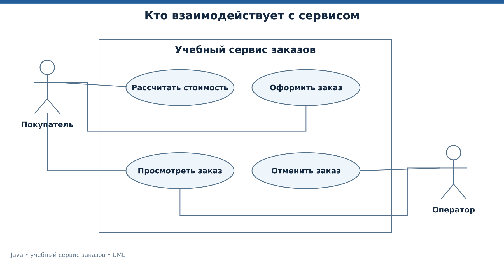

# Лекция 1. От бизнес-задачи к первой программе

Начинаем без требования знать Java. К концу занятия вы сможете запустить программу, объяснить её входные данные, проследить вычисление и найти место ошибки. Сквозной учебный пример — магазин, который постепенно получает сервис заказов. Все цены, правила скидок и ситуации этого магазина придуманы для обучения.

Рабочая версия курса — Java 25. Основные демонстрации используют совместимый с Java 17 синтаксис, поэтому их можно повторить и на JDK 17+. Особенности, требующие именно JDK 25, явно отделены. Команды выполняются из корня `java-course`.

[Все лекции](../README.md) · [Текст преподавателя](../speaker-notes/01-foundations.md)

## Маршрут занятия

| Блок | Что разбираем |
|---|---|
| [L01-01](#l01-01) | Программа начинается с договорённости |
| [L01-02](#l01-02) | JDK, компилятор и запуск |
| [L01-03](#l01-03) | Данные, типы и осмысленные имена |
| [L01-04](#l01-04) | Выражения и выбор ветви |
| [L01-05](#l01-05) | Массив, цикл и метод |
| [L01-06](#l01-06) | Строки и ссылки без загадок |
| [L01-07](#l01-07) | Демонстрация расчёта и наблюдение за ошибкой |
| [L01-08](#l01-08) | Задачи на понимание и переход к объектам |

---

<a id="l01-01"></a>

## L01-01. Программа начинается с договорённости

Покупатель заказывает две книги по 1299 рублей. Менеджер говорит, что при покупке от двух единиц действует скидка 5 процентов. Разработчику ещё нужно выяснить, что считать единицей, когда округлять копейки и можно ли оформить нулевое количество. Если этого не сделать, программа будет точно выполнять неточно сформулированное правило.

Для первого примера принимаем явный договор.

- Один запуск рассчитывает один товар, количество от 1 до 100.
- Цена хранится в копейках и не бывает отрицательной.
- Скидка применяется ко всей сумме при количестве не меньше двух.
- В этой учебной версии дробная часть копейки отбрасывается. Это выбранное правило примера, а не универсальное правило расчётов.

Вход — цена и количество. Выход — сумма до скидки, скидка, итог. Проверяемый результат для двух книг получаем вручную. `129900 × 2 = 259800` копеек. `259800 × 5 / 100 = 12990` копеек скидки. `259800 − 12990 = 246810` копеек к оплате.

Так появляется первый тест ещё до первой строки Java. Его смысл состоит в независимой проверке ожидаемого результата. Если программа выдаст другую сумму, у нас уже есть основание разбираться.



*UML вариантов использования учебного сервиса заказов.* [Исходник UML](../diagrams/01-use-cases.puml).

На схеме показан будущий сервис целиком. Сегодня реализуем только расчёт. UML отделяет действующее лицо от действий системы. Устройство классов из такой схемы ещё не следует. [Обозначения UML][UML].

---

<a id="l01-02"></a>

## L01-02. JDK, компилятор и запуск

Исходный файл содержит текст программы. Компилятор `javac` проверяет допустимость конструкций и создаёт файлы классов. Команда `java` запускает приложение в виртуальной машине. JDK содержит инструменты разработки и среду выполнения. IDE помогает редактировать и отлаживать код, но не заменяет понимание этих шагов. [Руководство javac][JAVAC], [руководство java][JAVA].

Проверьте установленную среду в терминале.

```bash
java --version
javac --version
```

Обе команды должны ссылаться на выбранный JDK. Если версии различаются, проверьте `PATH` и настройку SDK в IDE. Для курса выберите JDK 25, а не только среду выполнения.

Первая самостоятельная программа в файле `Hello.java` выглядит так.

```java
public class Hello {
    public static void main(String[] args) {
        System.out.println("Заказ принят в обработку");
    }
}
```

```bash
javac -encoding UTF-8 Hello.java
java Hello
```

Имя публичного класса и имя файла согласованы. В команде запуска пишем имя класса без `.class`. Метод `main` в показанной форме служит точкой входа. `args` хранит аргументы командной строки. `println` выводит значение и переводит строку. Для одиночного файла JDK также поддерживает запуск `java Hello.java`. Он удобен для демонстрации, но обычную цепочку компиляции нужно понимать. [Запуск исходных файлов][JAVA].

Если пропущена точка с запятой, ошибка обнаружится при компиляции. Если строка аргумента не является числом, программа может скомпилироваться и упасть уже при выполнении. Эти события происходят на разных этапах.

---

<a id="l01-03"></a>

## L01-03. Данные, типы и осмысленные имена

Переменная имеет тип и хранит значение. В Java тип выражения известен на этапе компиляции. Примитивные типы и ссылочные типы имеют разную семантику значений. Для начала нам достаточно следующего набора. [Типы Java][JLS4].

| Тип | Пример | Что моделируем |
|---|---|---|
| `int` | `int quantity = 2;` | Количество товара |
| `long` | `long priceCents = 129_900L;` | Цену в копейках |
| `boolean` | `boolean paid = false;` | Ответ да или нет |
| `double` | `double temperature = 21.5;` | Приближённое измерение |
| `char` | `char grade = 'A';` | Одну кодовую единицу UTF-16 |
| `String` | `String sku = "BOOK";` | Текстовый идентификатор |

У Java восемь примитивных типов — `byte`, `short`, `int`, `long`, `float`, `double`, `char`, `boolean`. `String` в этот список не входит. `char` не всегда совпадает с одним видимым символом, поэтому подсчёт человеческих символов требует отдельного определения. [JLS][JLS4], [String][STRING].

Суффикс `L` обозначает литерал типа `long`, а подчёркивание улучшает чтение числа. Имя `priceCents` объясняет единицу измерения. Имя `x` такого объяснения не даёт.

`var quantity = 2;` означает вывод типа локальной переменной компилятором, а не переменную с произвольным типом. Следующее присваивание `quantity = "two";` недопустимо. `final` запрещает повторное присваивание переменной. Оно само по себе не делает объект неизменяемым. [Локальные объявления][JLS14], [final][JLS4].

Для целых чисел обычные операции не обязаны сообщать о переполнении. В расчёте используем `Math.multiplyExact`, чтобы недопустимый результат не превратился в правдоподобное другое число. В следующей лекции добавим защиту на уровне модели. [Math.multiplyExact][MATH].

---

<a id="l01-04"></a>

## L01-04. Выражения и выбор ветви

В выражении `quantity >= 2` получается `boolean`. Оператор `if` выбирает действие по этому результату. В первом расчёте правило скидки можно написать развёрнуто.

```java
long discount;
if (quantity >= 2) {
    discount = gross * 5 / 100;
} else {
    discount = 0;
}
```

Тернарное выражение сокращает именно такой простой выбор значения. Когда внутри ветки появляются несколько действий, явный `if` обычно легче обсуждать. Это решение о читаемости нашего кода. Семантика условных конструкций описана в [JLS][JLS14].

```java
long discount = quantity >= 2 ? gross * 5 / 100 : 0;
```

У целочисленного деления дробная часть отбрасывается к нулю. Поэтому `5 / 2` даёт `2`, а `5 / 2.0` даёт `2.5`. Скобки и порядок вычисления влияют на результат. Например, `5 / 100 * gross` сначала вычисляет ноль. [Операторы выражений][JLS15].

Логические `&&` и `||` вычисляют правую часть только при необходимости. Условие `sku != null && !sku.isBlank()` не вызывает метод у `null`. Сначала проверяется существование ссылки, затем содержимое строки. `&` над логическими значениями вычисляет обе стороны. [Условные логические операторы][JLS15].

Для выбора по фиксированным категориям пригодно выражение `switch`.

```java
int deliveryDays = switch (region) {
    case "LOCAL" -> 1;
    case "NEAR" -> 3;
    default -> 7;
};
```

Здесь `region` заранее объявлена как непустая строка. Это фрагмент для разбора, а не отдельный запускаемый файл. Следующий шаг — понять, когда выбор нужно повторить для нескольких товаров.

---

<a id="l01-05"></a>

## L01-05. Массив, цикл и метод

Массив хранит фиксированное число элементов одного типа. Индекс первого элемента равен нулю. В массиве из трёх элементов допустимы индексы 0, 1 и 2. Обращение к индексу 3 обнаруживается во время выполнения. [Массивы и доступ к элементам][JLS15].

```java
int[] quantities = {2, 1, 3};
int count = 0;
for (int quantity : quantities) {
    count += quantity;
}
System.out.println(count); // 6
```

Цикл `for-each` подходит, когда нужен каждый элемент, а индекс не важен. Обычный `for` удобен, когда важно положение элемента. `while` повторяет действие, пока условие истинно. Для любого цикла полезно назвать условие завершения, иначе ошибка в изменении счётчика может сделать повторение бесконечным. [Операторы цикла][JLS14].

Метод выделяет действие с понятным входом и выходом. Вместо того чтобы повторять умножение и проверки, договор расчёта помещаем в `total`.

```java
static long total(long unitPrice, int quantity) {
    if (unitPrice < 0 || quantity < 1 || quantity > 100) {
        throw new IllegalArgumentException("Price or quantity is invalid");
    }
    return Math.multiplyExact(unitPrice, quantity);
}
```

`long` перед именем — тип возвращаемого значения. Параметры после имени — входные данные. `return` завершает выполнение метода с результатом. `throw` завершает обычный путь исключением, сообщая о нарушенном договоре. Подробно разберём обработку исключений в лекции 3. [Методы][JLS8], [исключения][JLS11].

Java передаёт аргументы по значению. Для примитива копируется значение примитива, для ссылочного типа — значение ссылки. Переприсваивание параметра не переприсваивает переменную вызывающего кода. Это правило пригодится, когда вместо одного числа появится целый заказ. [Вызов метода][JLS15].

---

<a id="l01-06"></a>

## L01-06. Строки и ссылки без загадок

Строки сравнивают по содержимому методом `equals`. Оператор `==` для ссылок проверяет, указывают ли они на один объект. Это разные вопросы. [String][STRING], [равенство ссылок][JLS15].

```java
String a = new String("BOOK");
String b = new String("BOOK");
System.out.println(a == b);      // false
System.out.println(a.equals(b)); // true
```

В примере намеренно создаются два объекта. В обычном прикладном коде писать `new String` для каждого литерала не нужно. Сравнение литералов через `==` иногда даёт ожидаемый результат из-за интернирования, но это не превращает его в проверку текстового содержания.

Объект `String` неизменяем. Вызов `sku.toLowerCase()` возвращает результат, а не меняет исходную строку. Чтобы использовать новый текст, нужно сохранить результат. Для машинных идентификаторов преобразование регистра должно учитывать выбранную локаль, например `Locale.ROOT`. [String][STRING].

```java
String sku = "BOOK";
String normalized = sku.toLowerCase(java.util.Locale.ROOT);
System.out.println(sku);        // BOOK
System.out.println(normalized); // book
```

`null` означает отсутствие ссылки на объект, а не пустую строку. `""` — существующая строка длины ноль. Пробелы — ещё один отдельный случай. Поэтому проверка данных начинается с ответа, какие из этих состояний допустимы по договору.

Когда требуется многократно наращивать текст в цикле, можно использовать `StringBuilder`. Выбирать его ради каждого короткого выражения не требуется. Сначала добиваемся ясности, а необходимость оптимизации проверяем на конкретной нагрузке.

---

<a id="l01-07"></a>

## L01-07. Демонстрация расчёта и наблюдение за ошибкой

Откройте [полный Main.java](../examples/01-start/Main.java). В файле нет скрытых зависимостей. Сначала прочитайте `total`, затем `main`. Такой порядок помогает увидеть договор раньше конкретного использования.

```bash
java tools/Run.java 01
```

Ожидаемый вывод получен из фиксированных входных данных.

```text
GROSS_CENTS=259800
DISCOUNT_CENTS=12990
PAY_CENTS=246810
ITEMS=6
```

Сумма `ITEMS` равна `2 + 1 + 3`. Это отдельная демонстрация массива и цикла, она не добавляет позиции в денежный расчёт. Не связывайте независимые учебные фрагменты причинно только потому, что они находятся в одном методе.

Чтобы передать своё количество, можно запустить исходный файл непосредственно.

```bash
java examples/01-start/Main.java 1
java examples/01-start/Main.java 0
java examples/01-start/Main.java two
```

Для 1 получаем `PAY_CENTS=129900`. Для 0 срабатывает наша проверка количества. Для `two` преобразование `Integer.parseInt` не может получить число. Последние два запуска намеренно завершаются ошибкой и служат наблюдением, а не успешным пользовательским интерфейсом.

В отладчике поставьте точку останова перед вычислением скидки. Посмотрите `quantity`, `gross` и будущий результат. Сделайте один шаг и сопоставьте состояние с ручным расчётом. Отладчик показывает конкретный путь выполнения, а не доказывает корректность всех возможных входов.

---

<a id="l01-08"></a>

## L01-08. Задачи на понимание и переход к объектам

Предскажите результат без запуска. Здесь переменные специально названы коротко, чтобы внимание было на правилах языка.

```java
int x = 5;
int y = x;
y++;
System.out.println(x);
System.out.println(y);
```

Вторая задача показывает изменение по ссылке.

```java
final int[] values = {1, 2};
values[0] = 9;
System.out.println(values[0]);
// values = new int[]{3, 4};
```

Третья задача относится к типам вычислений.

```java
double result = 5 / 2;
System.out.println(result);
```

Ответы и пошаговый разбор находятся в соответствующем блоке [текста преподавателя](../speaker-notes/01-foundations.md#l01-08). Первое задание проверяет копирование примитивного значения, второе — границу действия `final`, третье — тип операндов до присваивания. Основания — [JLS о переменных][JLS4] и [JLS о выражениях][JLS15].

Практическое продолжение — добавить стоимость доставки 30000 копеек для итогов меньше 200000 копеек. Сначала письменно решите, сравнивается сумма до скидки или после неё. Затем приведите три собственных примера, среди них ровно граничную сумму. Только после этого изменяйте код.

К следующей лекции нужно уметь запустить файл, объяснить проверку ввода и показать место вычисления результата. У программы уже есть данные и действия. Дальше объединим связанные данные с правилами так, чтобы другие части программы не могли случайно разрушить заказ.

[Следующая лекция](./02-object-model.md)


## Официальные источники

[JLS4]: https://docs.oracle.com/javase/specs/jls/se25/html/jls-4.html "JLS 25, глава 4 — типы, значения, переменные"
[JLS8]: https://docs.oracle.com/javase/specs/jls/se25/html/jls-8.html "JLS 25, глава 8 — классы, конструкторы, record"
[JLS11]: https://docs.oracle.com/javase/specs/jls/se25/html/jls-11.html "JLS 25, глава 11 — исключения"
[JLS14]: https://docs.oracle.com/javase/specs/jls/se25/html/jls-14.html "JLS 25, глава 14 — операторы и управление потоком"
[JLS15]: https://docs.oracle.com/javase/specs/jls/se25/html/jls-15.html "JLS 25, глава 15 — выражения и вызовы методов"
[JAVAC]: https://docs.oracle.com/en/java/javase/25/docs/specs/man/javac.html "JDK 25 — команда javac"
[JAVA]: https://docs.oracle.com/en/java/javase/25/docs/specs/man/java.html "JDK 25 — команда java"
[STRING]: https://docs.oracle.com/en/java/javase/25/docs/api/java.base/java/lang/String.html "Java SE 25 API — String"
[UML]: https://www.omg.org/spec/UML/2.5.1 "OMG — UML 2.5.1"

- [JLS 25, глава 4 — типы, значения, переменные][JLS4]
- [JLS 25, глава 8 — классы, конструкторы, record][JLS8]
- [JLS 25, глава 11 — исключения][JLS11]
- [JLS 25, глава 14 — операторы и управление потоком][JLS14]
- [JLS 25, глава 15 — выражения и вызовы методов][JLS15]
- [JDK 25 — команда javac][JAVAC]
- [JDK 25 — команда java][JAVA]
- [Java SE 25 API — String][STRING]
- [OMG — UML 2.5.1][UML]

[MATH]: https://docs.oracle.com/en/java/javase/25/docs/api/java.base/java/lang/Math.html "Java SE 25 API — Math"
