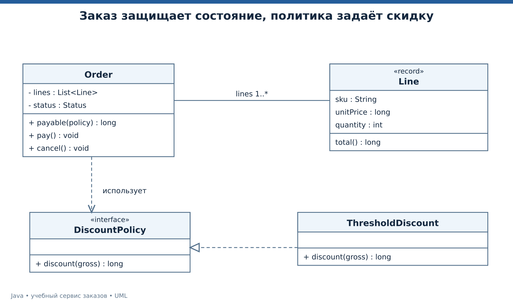
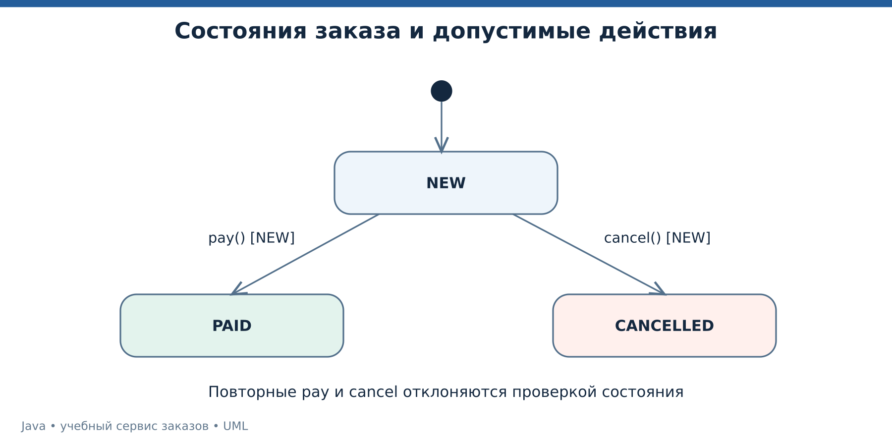
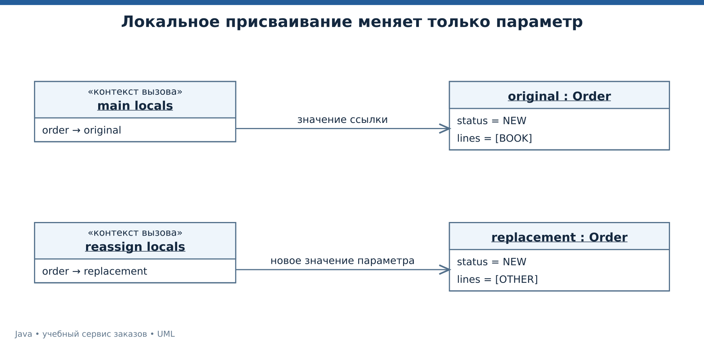

# Лекция 2. Объектная модель и защита бизнес-правил

Продолжаем с расчётом из лекции 1. Теперь заказ должен хранить позиции, переходить между допустимыми состояниями и принимать сменяемое правило скидки. Цель — не выучить определения ООП отдельно от кода, а увидеть, какие ошибки предотвращает выбранная модель.

[Все лекции](../README.md) · [Текст преподавателя](../speaker-notes/02-object-model.md)

## Маршрут занятия

| Блок | Что разбираем |
|---|---|
| [L02-01](#l02-01) | Класс, объект и ответственность |
| [L02-02](#l02-02) | Конструктор и инвариант |
| [L02-03](#l02-03) | Инкапсуляция и неизменяемые снимки |
| [L02-04](#l02-04) | Интерфейс, полиморфизм и композиция |
| [L02-05](#l02-05) | Идентичность, равенство и value object |
| [L02-06](#l02-06) | Состояния заказа и допустимые переходы |
| [L02-07](#l02-07) | Запуск модели и передача ссылки |
| [L02-08](#l02-08) | Хитрые задачи и критерии хорошей модели |

---

<a id="l02-01"></a>

## L02-01. Класс, объект и ответственность

Класс описывает структуру и поведение объектов. Конкретный заказ — объект с собственными данными. Два заказа могут быть созданы одним конструктором и при этом иметь разные позиции и состояния. [Классы и экземпляры][JLS8].

Для учебного магазина выделим `Line`, `Order` и `DiscountPolicy`. Позиция знает товар, цену и количество. Заказ управляет своим состоянием. Политика скидки отвечает за одно изменяемое правило расчёта. Это наше проектное решение, основанное на различии причин изменения этих частей.

Не стоит создавать класс для каждого существительного в разговоре. Сначала спрашиваем, какие данные должны изменяться вместе и кто защищает их ограничения. Если цена позиции не может быть отрицательной, это правило должно действовать при каждом её создании.



*UML классов заказа, позиции и политики скидки.* [Исходник UML](../diagrams/02-domain-classes.puml).

Пунктир с пустым треугольником показывает реализацию интерфейса. Кратность `1..*` означает хотя бы одну позицию заказа. Связь с политикой показывает использование, а не владение временем жизни этого объекта. [UML][UML].

Узкая ответственность упрощает вопрос при изменении требования. Если меняется порог скидки, начинаем с политики. Если меняются допустимые переходы, начинаем с заказа. Это не обещает отсутствия всех изменений в остальных файлах, но даёт осмысленную отправную точку.

---

<a id="l02-02"></a>

## L02-02. Конструктор и инвариант

Инвариант — условие, которое модель обязуется сохранять в своих допустимых состояниях. В нашем примере позиция имеет непустой артикул, неотрицательную цену и положительное количество. Заказ содержит хотя бы одну позицию.

```java
record Line(String sku, long unitPrice, int quantity) {
    Line {
        java.util.Objects.requireNonNull(sku);
        if (sku.isBlank() || unitPrice < 0 || quantity < 1) {
            throw new IllegalArgumentException("Invalid line");
        }
    }
}
```

Компактный конструктор `record` позволяет проверить параметры перед неявным присваиванием компонентам. Сам `record` создаёт компонентные поля, методы доступа и стандартные реализации `equals`, `hashCode`, `toString`. Это удобно для значения, но не отменяет проектирование правил. [Record classes][JLS8].

Обычный класс `Order` хранит `private` поле `status`. Внешний код не получает метод `setStatus` с произвольным значением. Вместо этого ему доступны действия `pay` и `cancel`, каждое со своим условием допустимости.

Конструктор не должен открывать сеть только потому, что объекту позднее понадобится сервер. Для данного курса выбираем конструкторы, которые принимают зависимости и проверяют локальные данные. Так создание объекта остаётся предсказуемым и пригодным для теста.

Проверка на границе HTTP понадобится даже при защищённой модели. На границе объясняем ошибку пользователю, а внутри модели сохраняем договор независимо от того, кто её вызвал — HTTP, тест или консоль.

---

<a id="l02-03"></a>

## L02-03. Инкапсуляция и неизменяемые снимки

В конструкторе заказа используем `List.copyOf(lines)`. Внешний список после этого можно очистить, но набор позиций созданного заказа не изменится. Полученная структура не допускает добавления и удаления элементов. При этом копирование списка поверхностное — сами элементы не превращаются автоматически в глубоко неизменяемые объекты. [List.copyOf][LIST].

```java
private final List<Line> lines;

Order(List<Line> lines) {
    this.lines = List.copyOf(lines);
    if (this.lines.isEmpty()) {
        throw new IllegalArgumentException("Empty order");
    }
}
```

В нашем `Line` компоненты представлены строкой и примитивами, поэтому этот набор подходит для неизменяемого значения. Если бы компонентой была изменяемая коллекция, потребовалось бы отдельно решить вопрос защитного копирования.

`final List<Line>` запрещает переприсвоить поле. Ограничение изменения содержимого появляется от выбранной структуры и модели элементов, а не от одного слова `final`. [final-переменные][JLS4].

Нужно отличать три свойства.

| Свойство | Что запрещает |
|---|---|
| Неизменяемая переменная-ссылка | Присвоить этой переменной другое значение |
| Неизменяемая структура списка | Добавить, удалить, заменить элемент через этот список |
| Глубоко неизменяемый объект | Изменить доступное состояние всей его модели |

У `Collections.unmodifiableList` есть ещё одна тонкость — это представление над исходным списком. Изменения исходного списка могут быть видны через такое представление. Для самостоятельного снимка в нашем сценарии выбран `List.copyOf`. [Collections][COLLECTIONS].

---

<a id="l02-04"></a>

## L02-04. Интерфейс, полиморфизм и композиция

Интерфейс задаёт контракт поведения. `DiscountPolicy` обещает получить сумму до скидки и вернуть размер скидки. Заказу не требуется знать, какой конкретный класс реализует это правило. [Интерфейсы][JLS9].

```java
interface DiscountPolicy {
    long discount(long gross);
}

static final class ThresholdDiscount implements DiscountPolicy {
    @Override
    public long discount(long gross) {
        return gross >= 200_000 ? gross / 20 : 0;
    }
}
```

Заказ проверяет дополнительное предметное условие `0 <= discount <= gross`. Одного совпадения сигнатуры недостаточно для корректной реализации договора. Например, отрицательная скидка технически имеет тип `long`, но для нашего магазина недопустима.

Композиция здесь означает, что поведение заказа использует переданный объект политики. Чтобы добавить правило для сотрудника, создаём другую реализацию или, позднее, лямбду. Не требуется создавать наследника `EmployeeDiscountOrder` только ради различия скидки.

Наследование класса полезно, когда подтип действительно сохраняет договор базового типа. `extends` не стоит использовать только ради доступа к нескольким строкам кода. В Java класс имеет одного непосредственного суперкласса и может реализовывать несколько интерфейсов. [Наследование классов][JLS8].

Перегрузка выбирает между одноимёнными методами с разными параметрами. Переопределение даёт реализацию унаследованного экземплярного метода. Они отвечают на разные вопросы. `@Override` помогает компилятору проверить наше намерение переопределить метод.

---

<a id="l02-05"></a>

## L02-05. Идентичность, равенство и value object

Два заказа с одинаковой суммой не обязательно являются одним заказом. Две позиции с одинаковыми компонентами могут считаться равными значениями. Поэтому перед реализацией `equals` нужно определить, что означает равенство в предметной области.

У базового `Object.equals` проверяется идентичность. Другие классы могут переопределить этот метод. Контракт требует согласованного `hashCode` для равных объектов. Именно на эти правила опираются хеш-коллекции следующей лекции. [Object][OBJECT].

```java
var a = new Line("BOOK", 100_00, 2);
var b = new Line("BOOK", 100_00, 2);
System.out.println(a == b);      // false
System.out.println(a.equals(b)); // true
```

Сгенерированное равенство `record` использует его компоненты. Это удобно для value object — объекта, смысл которого определяется значением. Но если record содержит массив, равенство массива не становится автоматически сравнением всех элементов. Выбор структуры данных остаётся ответственностью автора модели. [Record classes][JLS8].

Для будущего сервиса создадим устойчивый идентификатор заказа, а пользовательский ключ повторного запроса будем хранить отдельно. Идентификатор отвечает на вопрос, какой заказ читаем. Ключ запроса отвечает на вопрос, повторно ли обрабатываем одну команду. Совпадение их ролей нельзя предполагать без договора.

`toString` удобно для отладки, но нельзя автоматически считать его безопасным форматом журнала. Когда объект содержит секреты или персональные данные, набор выводимых полей нужно выбирать явно. В этом курсе демонстрационные значения не содержат таких данных.

---

<a id="l02-06"></a>

## L02-06. Состояния заказа и допустимые переходы

В учебном заказе три состояния. Новый заказ можно оплатить или отменить. Оплаченный и отменённый заказ в этой модели больше не меняются. Возвраты, частичные оплаты и отгрузки пока не моделируются. Это ограниченная учебная модель, а не описание любого магазина.



*UML состояний заказа с охраняемыми переходами.* [Исходник UML](../diagrams/02-order-states.puml).

Метод `pay` сначала проверяет исходное состояние, затем меняет его. Если проверка не проходит, состояние сохраняется.

```java
void pay() {
    if (status != Status.NEW) {
        throw new IllegalStateException("Only NEW can be paid");
    }
    status = Status.PAID;
}
```

На этом этапе класс предназначен для последовательного использования одним потоком. Наличие проверки само по себе не делает операцию потокобезопасной. В лекции 6 обсудим, что происходит, когда два потока читают одно состояние одновременно.

Диаграмма состояний отвечает, какие изменения допустимы. Диаграмма классов отвечает, какие сущности и связи существуют. Диаграмма последовательности далее покажет порядок взаимодействия объектов. Эти представления дополняют друг друга, а не повторяют одно изображение разными значками. [UML][UML].

Хорошая проверка для текущей модели — попытка оплатить заказ второй раз. Она должна завершиться понятным отказом и оставить состояние `PAID`. Следующее занятие научит отделять подобный ожидаемый отказ от технического сбоя.

---

<a id="l02-07"></a>

## L02-07. Запуск модели и передача ссылки

Запустите демонстрацию и откройте [полный исходник](../examples/02-oop/Main.java).

```bash
java tools/Run.java 02
```

```text
LINES=1
PAY_CENTS=246810
BEFORE=NEW
AFTER=PAID
SECOND_PAYMENT=REJECTED
FINAL_LIST_SIZE=1
```

`LINES=1` показывает, что очистка первоначального списка не изменила снимок заказа. Итог совпадает с первым занятием, но правило расчёта теперь получено через интерфейс. Повторная оплата отклонена. Последняя строка подтверждает, что `final` у переменной списка не запрещает вызов `add`.

Посмотрите на метод `reassign`. В нём параметру присваивается новый заказ. Внешняя переменная после возврата всё ещё указывает на прежний заказ. Передано значение ссылки, поэтому переприсваивание параметра остаётся локальным. [Передача аргументов][JLS15].

```java
static void reassign(Order order) {
    order = new Order(List.of(new Line("OTHER", 1, 1)));
}
```

Если вместо присваивания вызвать `order.pay()`, изменится объект, доступный по скопированной ссылке. Это не превращает Java в язык с передачей переменных по ссылке. Один и тот же объект доступен через две разные переменные, хранящие одинаковое значение ссылки.



*UML объектов до и после локального переприсваивания параметра.* [Исходник UML](../diagrams/02-object-links.puml).

Упражнение для отладчика — поставить остановку в `reassign`, посмотреть параметр, сделать шаг через присваивание и вернуться в `main`. Наблюдаемое различие привяжите к конкретным переменным.

---

<a id="l02-08"></a>

## L02-08. Хитрые задачи и критерии хорошей модели

Задача 1. Есть `record Box(List<String> tags) {}`. Создали `ArrayList`, передали его в `Box`, затем добавили элемент в исходный список. Изменится ли `box.tags().size()`? Как изменить конструктор, чтобы получить снимок структуры?

Задача 2. Метод принимает `DiscountPolicy` и получает от него скидку `-100`. Код компилируется. Где нарушен договор и кто должен обнаружить нарушение?

Задача 3. Разработчик предлагает добавить публичный `setStatus`, чтобы тестам было удобно создавать оплаченный заказ. Какая возможность случайно появится у остального приложения? Как тест может получить состояние через допустимый сценарий?

Разбор находится в [L02-08 текста преподавателя](../speaker-notes/02-object-model.md#l02-08). На языке Java ответы опираются на [record][JLS8], [интерфейсы][JLS9] и [List][LIST]. Оценка проектных решений относится к договору нашего учебного примера.

При самостоятельной работе добавьте вторую политику скидки с фиксированной суммой, но сохраните ограничение на результат. Не меняйте `Order` для каждого нового типа клиента. Затем добавьте тестовый сценарий отмены и попытки оплаты после отмены.

Перед переходом дальше проверьте модель тремя вопросами. Можно ли создать бессмысленный объект? Может ли внешняя ссылка незаметно изменить его данные? Можно ли выполнить запрещённый переход обычным публичным методом? Если ответ да, уточните границу ответственности и только затем добавляйте новые функции.

[Следующая лекция](./03-collections-errors.md)


## Официальные источники

[JLS4]: https://docs.oracle.com/javase/specs/jls/se25/html/jls-4.html "JLS 25, глава 4 — типы, значения, переменные"
[JLS8]: https://docs.oracle.com/javase/specs/jls/se25/html/jls-8.html "JLS 25, глава 8 — классы, конструкторы, record"
[JLS9]: https://docs.oracle.com/javase/specs/jls/se25/html/jls-9.html "JLS 25, глава 9 — интерфейсы и аннотации"
[JLS15]: https://docs.oracle.com/javase/specs/jls/se25/html/jls-15.html "JLS 25, глава 15 — выражения и вызовы методов"
[OBJECT]: https://docs.oracle.com/en/java/javase/25/docs/api/java.base/java/lang/Object.html "Java SE 25 API — Object"
[LIST]: https://docs.oracle.com/en/java/javase/25/docs/api/java.base/java/util/List.html "Java SE 25 API — List"
[UML]: https://www.omg.org/spec/UML/2.5.1 "OMG — UML 2.5.1"

- [JLS 25, глава 4 — типы, значения, переменные][JLS4]
- [JLS 25, глава 8 — классы, конструкторы, record][JLS8]
- [JLS 25, глава 9 — интерфейсы и аннотации][JLS9]
- [JLS 25, глава 15 — выражения и вызовы методов][JLS15]
- [Java SE 25 API — Object][OBJECT]
- [Java SE 25 API — List][LIST]
- [OMG — UML 2.5.1][UML]

[COLLECTIONS]: https://docs.oracle.com/en/java/javase/25/docs/api/java.base/java/util/Collections.html "Java SE 25 API — Collections"
