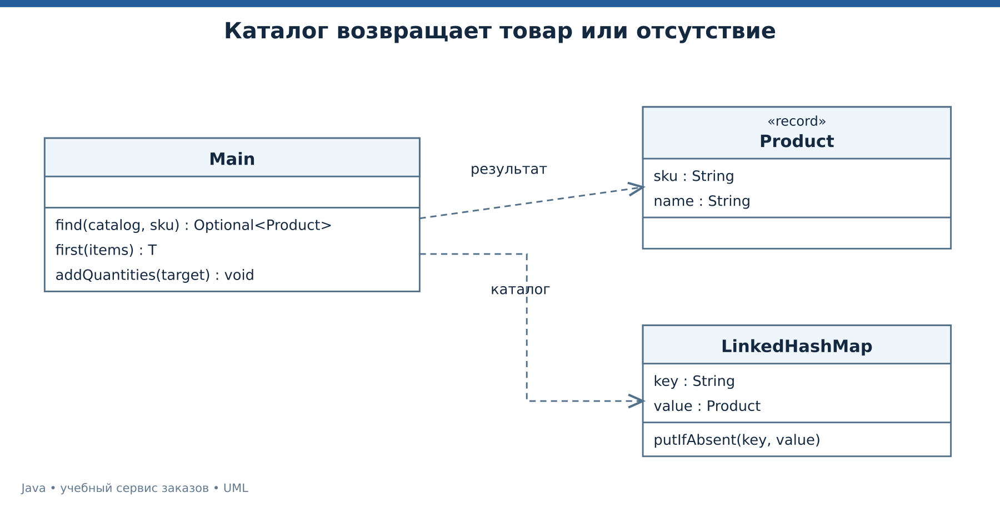
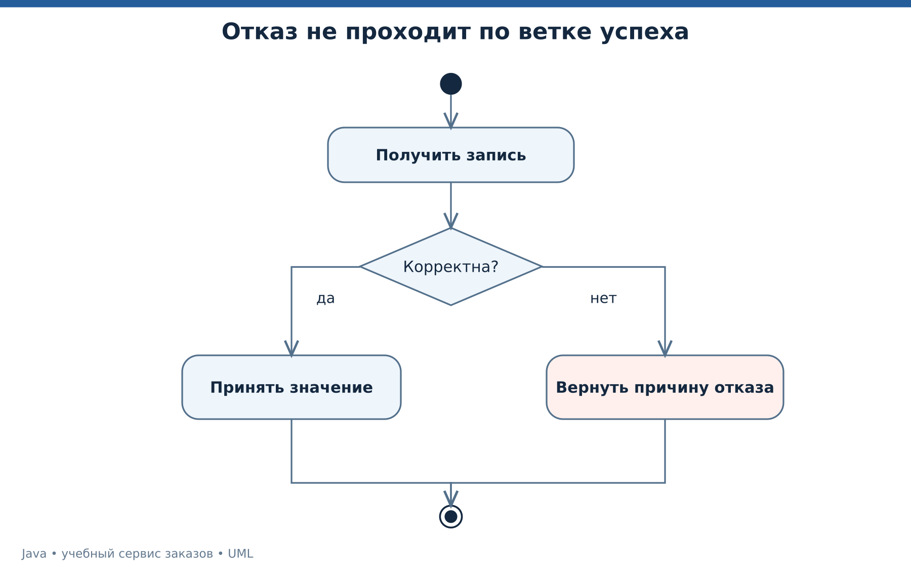

# Лекция 3. Коллекции, обобщения и обработка ошибок

У магазина уже есть защищённый заказ. Теперь появляются каталог из многих товаров, поиск по артикулу и отказы при неверных данных. Научимся выбирать структуру под операцию, понимать ограничения generics и передавать причину ошибки, не теряя её смысл.

[Все лекции](../README.md) · [Текст преподавателя](../speaker-notes/03-collections-errors.md)

## Маршрут занятия

| Блок | Что разбираем |
|---|---|
| [L03-01](#l03-01) | Выбираем коллекцию по вопросу к данным |
| [L03-02](#l03-02) | equals, hashCode и опасность изменяемого ключа |
| [L03-03](#l03-03) | Generics сохраняют типовой договор |
| [L03-04](#l03-04) | Отсутствующее значение и Optional |
| [L03-05](#l03-05) | Исключение сохраняет причину отказа |
| [L03-06](#l03-06) | Ресурс закрывается независимо от результата |
| [L03-07](#l03-07) | Живая демонстрация каталога |
| [L03-08](#l03-08) | Задачи о типах, ключах и исключениях |

---

<a id="l03-01"></a>

## L03-01. Выбираем коллекцию по вопросу к данным

Коллекция нужна не просто потому, что элементов много. Сначала назовите операцию. Показать товары в определённом порядке, проверить наличие артикула и быстро получить товар по ключу — три разных запроса.

| Структура | Нужное свойство | Учебный пример |
|---|---|---|
| `List` | Последовательность, допускающая повторения | Позиции заказа |
| `Set` | Отсутствие дубликатов по договору равенства | Разрешённые роли |
| `Map` | Связь ключа и значения | Артикул и товар |

`Map` не является подтипом `Collection`, хотя относится к Collections Framework. Поэтому одинаковые слова «коллекция данных» в разговоре не означают одинаковую иерархию интерфейсов. [List][LIST], [Set][SET], [HashMap][HASHMAP].

`ArrayList` удобен для чтения по индексу. Доступ по индексу имеет постоянную стоимость, добавление в конец — амортизированную постоянную. Вставка в середину требует сдвига элементов. У `HashMap` базовые операции имеют ожидаемую постоянную стоимость при хорошем распределении хешей, но порядок обхода не гарантируется. [ArrayList][ARRAYLIST], [HashMap][HASHMAP].

Эти оценки описывают рост объёма работы при увеличении размера данных, а не обещают конкретное число миллисекунд. Для маленького списка линейный поиск может быть достаточно простым решением. Для измерений нужны реальные данные и условия выполнения.

В демонстрации используем `LinkedHashMap`, чтобы порядок вывода каталога был предсказуемым. Это сознательный выбор для показа, а не свойство любого словаря. [LinkedHashMap][LINKEDMAP].



*UML классов каталога и типизированного поиска.* [Исходник UML](../diagrams/03-collection-model.puml).

Далее нужно определить, что именно считается одним и тем же ключом. Здесь снова пригодится договор равенства из прошлой лекции.

---

<a id="l03-02"></a>

## L03-02. equals, hashCode и опасность изменяемого ключа

Хеш-коллекция сначала использует хеш для организации поиска, а затем сравнение ключей. Равные объекты должны иметь одинаковый `hashCode`; обратное не обязательно. Коллизии допустимы. [Object][OBJECT], [HashMap][HASHMAP].

Представим ключ `Customer`, у которого `equals` и `hashCode` зависят от email. Объект положили в `HashMap`, а затем email изменили. Поиск по изменённому ключу становится ненадёжным, потому что организация таблицы была построена по прежнему значению. Документация Map отдельно требует осторожности с изменяемыми ключами. Для каталога выберем неизменяемую строку артикула. [Договор Map][MAP].

```java
Map<String, Product> catalog = new LinkedHashMap<>();
for (Product product : products) {
    if (catalog.putIfAbsent(product.sku(), product) != null) {
        throw new IllegalArgumentException("Duplicate sku");
    }
}
```

Здесь дубликат — ошибка исходного каталога. Обычный `put` молча заменил бы предыдущий товар. `putIfAbsent` позволяет заметить уже существующее значение. В данном примере значения не бывают `null`, что делает интерпретацию результата однозначной. [Операции HashMap][HASHMAP].

Это последовательный код. Вызов метода с удобным названием не делает обычный `LinkedHashMap` общей потокобезопасной структурой. Атомарность между потоками зависит от конкретной реализации и её договора.

Учебная бизнес-ситуация — поставщик прислал две строки с одним артикулом и разными ценами. Мы выбрали отказ всего построения каталога, потому что молчаливое решение «последняя строка побеждает» скрывает конфликт данных. В другом процессе можно формировать отчёт конфликтов, но правило должно быть явным.

---

<a id="l03-03"></a>

## L03-03. Generics сохраняют типовой договор

`List<Product>` сообщает компилятору, какие элементы допустимы. При чтении не нужен ручной cast. Попытка добавить строку вместо товара обнаруживается до запуска. Raw type `List` теряет значимую часть такой проверки. [Параметризованные типы][JLS4].

```java
List<String> names = new ArrayList<>();
names.add("Анна");
String first = names.get(0);
// names.add(42); // Намеренная ошибка компиляции
```

`List<Integer>` не является подтипом `List<Number>`. Иначе через переменную второго типа можно было бы добавить `Double` в список, который обещает содержать только `Integer`. Это свойство называют инвариантностью параметризованных типов.

Когда метод только читает значения как `T`, можно принять производителя `? extends T`. Когда метод добавляет значения `Integer`, можно принять потребителя `? super Integer`.

```java
static <T> T first(List<? extends T> items) {
    if (items.isEmpty()) throw new IllegalArgumentException("Empty list");
    return items.get(0);
}

static void addQuantities(List<? super Integer> target) {
    target.add(2);
    target.add(3);
}
```

Из `List<? extends Number>` можно читать `Number`, но нельзя произвольно добавлять `Integer`. Неизвестный конкретный тип может оказаться `Double`. Из `List<? super Integer>` безопасно добавлять `Integer`, а прочитанное значение без дополнительного знания доступно как `Object`. [Wildcard и подтипизация][JLS4].

Обобщения в Java в основном реализованы через стирание типов. Нельзя написать `new T()` только на основании переменной типа, а проверка `instanceof List<String>` не является допустимой обычной проверкой параметра элементов. Для предметных данных нужны реальные проверки на входе, а не надежда на сохранение всех параметров типа во время выполнения.

---

<a id="l03-04"></a>

## L03-04. Отсутствующее значение и Optional

Поиск товара может завершиться без результата. Это ожидаемая ситуация, если артикул введён пользователем. Метод `find` возвращает `Optional<Product>`, чтобы явно показать такую возможность. [Optional][OPTIONAL].

```java
static Optional<Product> find(Map<String, Product> catalog, String sku) {
    return Optional.ofNullable(catalog.get(sku));
}
```

Вызывающий код выбирает действие. `orElse` даёт уже вычисленное значение по умолчанию. `orElseGet` вызывает поставщика только при отсутствии результата. `orElseThrow` переводит отсутствие в исключение, когда оно нарушает договор текущего сценария.

```java
Product product = find(catalog, "BOOK").orElseThrow();
boolean missing = find(catalog, "OTHER").isEmpty();
```

Не нужно бездумно заменять каждую nullable-переменную на `Optional`. В документации он прежде всего предназначен для возвращаемого значения метода, где отсутствие результата имеет смысл. Сам `Optional` при таком договоре не должен быть `null`. В коллекции результатов обычно удобнее вернуть пустую коллекцию, чем `Optional<List<T>>`, если два разных вида отсутствия не имеют предметного смысла.

Учебное правило нашего каталога — неизвестный артикул не подменяется случайным товаром. Для экрана поиска показываем отсутствие. Для операции оформления формируем отказ. Одна и та же ситуация обрабатывается по-разному на разных уровнях сценария.

Переход к исключениям естественен. Не всякое отсутствие является сбоем, и не всякий сбой разумно скрыть за пустым результатом.

---

<a id="l03-05"></a>

## L03-05. Исключение сохраняет причину отказа

У исключения есть тип, сообщение и при необходимости исходная причина. Оно прерывает обычный путь выполнения. Checked exceptions, например `IOException`, должны быть обработаны или объявлены в `throws`. Потомки `RuntimeException` и `Error` относятся к unchecked. [Модель исключений][JLS11].

Для курса используем следующее проектное разделение.

| Ситуация | Представление |
|---|---|
| Товар не найден в обычном поиске | Пустой `Optional` |
| В метод передано запрещённое количество | `IllegalArgumentException` |
| Выполнено недопустимое действие над состоянием | `IllegalStateException` |
| Файл не удалось прочитать | `IOException` с причиной |

Это согласованная схема нашего примера, а не требование языка назначать каждому бизнес-событию именно этот тип.

```java
try {
    order.pay();
} catch (IllegalStateException e) {
    System.out.println("Повторная оплата отклонена");
}
```

Перехватывать исключение стоит там, где можно принять осмысленное решение. Пустой `catch` скрывает проблему. `catch (Exception e)` вокруг всей программы с печатью «всё хорошо» уничтожает различие успеха и отказа. Повторять неизвестную операцию автоматически тоже опасно для смысла данных — предыдущая попытка могла успеть выполнить действие.

При переводе низкоуровневой ошибки в понятный контекст сохраняйте причину.

```java
throw new IOException("Invalid row " + number, cause);
```

В лекции 4 номер строки поможет найти повреждённую запись, а `cause` сохранит конкретную ошибку разбора. Внешний HTTP-ответ позднее получит краткий код, а техническая причина останется в серверной диагностике.

---

<a id="l03-06"></a>

## L03-06. Ресурс закрывается независимо от результата

Открытый файл, соединение и сетевой поток имеют жизненный цикл. Для объектов с договором `AutoCloseable` используется `try-with-resources`. Закрытие выполняется при выходе из блока, в том числе при исключении. При нескольких ресурсах закрытие идёт в обратном порядке объявления. [try-with-resources][JLS14].

```java
try (var reader = Files.newBufferedReader(path, StandardCharsets.UTF_8)) {
    String firstLine = reader.readLine();
    System.out.println(firstLine);
}
```

Фрагмент требует соответствующих импортов и переменной `path`; полный запускаемый вариант будет в лекции 4. Главное здесь — область владения ресурсом видна синтаксически.

Если основное действие и закрытие бросили исключения, исключение закрытия может оказаться suppressed у основного. Это позволяет сохранить первичную причину. Конструкция `finally` полезна для обязательного завершения действий, но `return` или новое исключение из `finally` могут заслонить исходный результат. Поэтому не помещаем туда бизнес-ответ.



*UML деятельности обработки записи с путями успеха и ошибки.* [Исходник UML](../diagrams/03-error-activity.puml).

На схеме ошибочный путь не соединяется с сообщением об успешном принятии. Такая проверка процесса проста, но помогает заметить распространённую ошибку — сообщение «сохранено» в общей ветке после пустого `catch`.

В профессиональном коде границы владения ресурсами так же важны, как границы данных. Если метод открывает соединение и передаёт его дальше, нужно заранее определить, кто отвечает за закрытие.

---

<a id="l03-07"></a>

## L03-07. Живая демонстрация каталога

Откройте [Main.java каталога](../examples/03-collections/Main.java).

```bash
java tools/Run.java 03
```

```text
CATALOG=[BOOK, HUB]
FOUND=Java
MISSING=true
IDS=[10]
UNIQUE=2
FIRST=2
IMMUTABLE_LIST=REJECTED
```

В каталоге два артикула в порядке добавления. По `BOOK` найдено имя товара, по `OTHER` результата нет. В наборе `A, A, B` две уникальные строки.

Строка `IDS=[10]` получена двумя разными перегрузками `remove`.

```java
var ids = new ArrayList<>(List.of(10, 20, 30));
ids.remove(1);                  // Удаляется элемент с индексом 1
ids.remove(Integer.valueOf(30)); // Удаляется значение 30
```

После первого вызова список содержит `[10, 30]`, после второго `[10]`. Для `List<Integer>` различие индекса и значения особенно легко пропустить. Правила выбора перегрузки описаны в [JLS][JLS15], операции — в [List][LIST].

Попытка добавить товар в список от `List.of` отклоняется. Это пример runtime-ограничения объекта коллекции. Компилятор видит интерфейс `List` с методом `add`, но конкретный объект не поддерживает изменение.

В отладчике остановитесь после `putIfAbsent`, затем после каждого `remove`. Каждый раз сформулируйте, какой договор вы сейчас проверяете. Так наблюдение превращается в целенаправленную диагностику.

---

<a id="l03-08"></a>

## L03-08. Задачи о типах, ключах и исключениях

Задача 1. Можно ли передать `List<Integer>` в метод, принимающий `List<Number>`? А в метод с `List<? extends Number>`? Что в последнем случае разрешено читать и записывать?

Задача 2. `HashSet` содержит два объекта с одинаковым email. Их класс не переопределяет `equals` и `hashCode`. Обязан ли размер набора быть равен одному?

Задача 3. Импорт ловит `Exception`, печатает ошибку, а затем всегда возвращает `true`. Может ли вызывающий код отличить отказ от успеха? Как изменить договор результата?

Задача 4. Почему последовательность `containsKey(key)` и `put(key, value)` не становится атомарной только потому, что каждый вызов понятен сам по себе?

Ответы находятся в [тексте преподавателя](../speaker-notes/03-collections-errors.md#l03-08). Опорные правила языка и API — [generics][JLS4], [Object][OBJECT], [исключения][JLS11].

Продолжение проекта — читать каталог из файла. Для подготовки составьте таблицу допустимых данных и причин отказа. Продумайте отдельно отсутствующий файл, неверное число, дублирующий артикул и пустой файл. Затем выберите, принимает ли импорт корректные строки частично или отклоняет пакет целиком. Следующая лекция покажет конкретную реализацию ограниченного формата.

[Следующая лекция](./04-files-money-time.md)


## Официальные источники

[JLS4]: https://docs.oracle.com/javase/specs/jls/se25/html/jls-4.html "JLS 25, глава 4 — типы, значения, переменные"
[JLS11]: https://docs.oracle.com/javase/specs/jls/se25/html/jls-11.html "JLS 25, глава 11 — исключения"
[JLS14]: https://docs.oracle.com/javase/specs/jls/se25/html/jls-14.html "JLS 25, глава 14 — операторы и управление потоком"
[JLS15]: https://docs.oracle.com/javase/specs/jls/se25/html/jls-15.html "JLS 25, глава 15 — выражения и вызовы методов"
[OBJECT]: https://docs.oracle.com/en/java/javase/25/docs/api/java.base/java/lang/Object.html "Java SE 25 API — Object"
[LIST]: https://docs.oracle.com/en/java/javase/25/docs/api/java.base/java/util/List.html "Java SE 25 API — List"
[ARRAYLIST]: https://docs.oracle.com/en/java/javase/25/docs/api/java.base/java/util/ArrayList.html "Java SE 25 API — ArrayList"
[HASHMAP]: https://docs.oracle.com/en/java/javase/25/docs/api/java.base/java/util/HashMap.html "Java SE 25 API — HashMap"
[SET]: https://docs.oracle.com/en/java/javase/25/docs/api/java.base/java/util/Set.html "Java SE 25 API — Set"
[OPTIONAL]: https://docs.oracle.com/en/java/javase/25/docs/api/java.base/java/util/Optional.html "Java SE 25 API — Optional"

- [JLS 25, глава 4 — типы, значения, переменные][JLS4]
- [JLS 25, глава 11 — исключения][JLS11]
- [JLS 25, глава 14 — операторы и управление потоком][JLS14]
- [JLS 25, глава 15 — выражения и вызовы методов][JLS15]
- [Java SE 25 API — Object][OBJECT]
- [Java SE 25 API — List][LIST]
- [Java SE 25 API — ArrayList][ARRAYLIST]
- [Java SE 25 API — HashMap][HASHMAP]
- [Java SE 25 API — Set][SET]
- [Java SE 25 API — Optional][OPTIONAL]

[MAP]: https://docs.oracle.com/en/java/javase/25/docs/api/java.base/java/util/Map.html "Java SE 25 API — Map"

[LINKEDMAP]: https://docs.oracle.com/en/java/javase/25/docs/api/java.base/java/util/LinkedHashMap.html "Java SE 25 API — LinkedHashMap"
