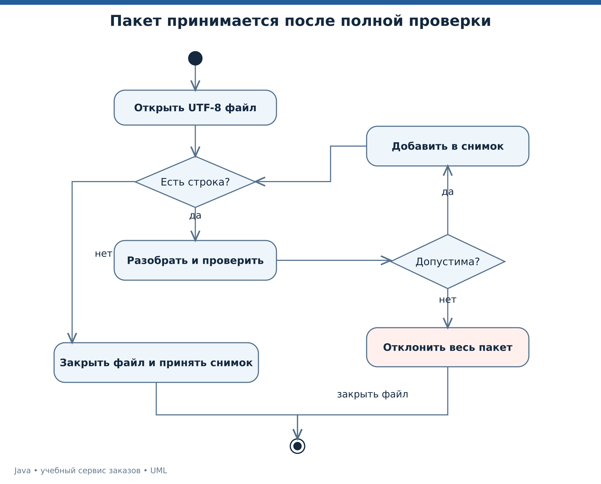

# Лекция 4. Файлы, денежные значения и время

На вход магазина приходит выгрузка поставщика. Нужно прочитать её в понятной кодировке, проверить каждую строку, точно посчитать сумму и сформировать отчёт. Лекция объединяет ввод-вывод с моделью данных, а не рассматривает файлы отдельно от задачи.

[Все лекции](../README.md) · [Текст преподавателя](../speaker-notes/04-files-money-time.md)

## Маршрут занятия

| Блок | Что разбираем |
|---|---|
| [L04-01](#l04-01) | Сначала определяем формат импорта |
| [L04-02](#l04-02) | Path, Files и кодировка |
| [L04-03](#l04-03) | Проверяем строку и сохраняем контекст ошибки |
| [L04-04](#l04-04) | Деньги и точная десятичная арифметика |
| [L04-05](#l04-05) | Время события и локальная дата |
| [L04-06](#l04-06) | Отчёт и граница сохранения |
| [L04-07](#l04-07) | Полный запуск импорта |
| [L04-08](#l04-08) | Задачи и следующий шаг |

---

<a id="l04-01"></a>

## L04-01. Сначала определяем формат импорта

В [order-lines.tsv](../data/order-lines.tsv) каждая строка содержит артикул, количество и цену в рублях. Разделитель — табуляция. Внутри поля запрещены табуляции и переводы строк, кавычки не имеют специального значения. Заголовка нет. Это ограниченный учебный TSV, а не универсальный парсер CSV.

```text
BOOK    2    1499.90
HUB     1    2490.00
```

На экране табуляции показаны как расстояния. В файле используются настоящие символы табуляции. Десятичный разделитель — точка, валюта во всём файле одна. Строки с другой структурой отклоняются, а не «исправляются» предположением о намерении автора.

Выбираем договор принятия пакета целиком. Сначала все записи читаются и превращаются в проверенные значения. Только после успешного завершения формируем отчёт. Некорректная строка не должна сопровождаться сообщением об успешном импорте.



*UML деятельности импорта с проверкой всех записей перед принятием.* [Исходник UML](../diagrams/04-import-activity.puml).

Ограничения демонстрации — файл до 65536 байт и не более 1000 строк. Они выбраны для учебного локального файла. Проверка размера перед чтением не является защитой от конкурентной подмены файла или произвольного сетевого потока. Такие источники требуют отдельного ограничения фактически прочитанных байтов.

Смысл формата следует документировать рядом с кодом. Расширение `.tsv` само по себе не сообщает, есть ли заголовок, какие поля обязательны и какой принят разделитель дробной части.

---

<a id="l04-02"></a>

## L04-02. Path, Files и кодировка

`Path` представляет путь в файловой системе. Само создание `Path` не означает, что файл существует. `Files` предоставляет операции чтения, записи и проверки. Ошибки доступа обрабатываются как часть операции, а не только предварительным `exists`. Между проверкой и чтением состояние может измениться. [Files][FILES].

```java
Path input = Path.of("data/order-lines.tsv");
try (BufferedReader reader = Files.newBufferedReader(input, StandardCharsets.UTF_8)) {
    String line;
    while ((line = reader.readLine()) != null) {
        System.out.println(line);
    }
}
```

Относительный путь отсчитывается от рабочей директории процесса, а не от папки исходного `.java` автоматически. Поэтому команды курса выполняются из корня проекта. Эта договорённость нужна и преподавателю, и студентам.

Байты не становятся текстом без выбора кодировки. В примере явно используем UTF-8. Даже если окружение по умолчанию совпало с ожиданиями, явная кодировка делает договор чтения видимым.

`Files.readString` удобен для небольшого файла. Для большого источника выбирают последовательную обработку, учитывая размер отдельной строки и общие ограничения. `Files.lines` возвращает поток, связанный с ресурсом, поэтому его нужно закрывать. Обычный `List.stream()` не открывает файл и не имеет той же внешней обязанности. [Files.lines][FILES].

В этом курсе не принимаем путь от HTTP-пользователя. Если такой интерфейс появится, простая склейка строк с именем файла не станет достаточной политикой доступа. Нужно отдельно определить разрешённое хранилище и способ сопоставления пользовательского идентификатора с файлом.

---

<a id="l04-03"></a>

## L04-03. Проверяем строку и сохраняем контекст ошибки

Строка сначала разбивается на поля, затем поля преобразуются в значения и проходят предметную проверку. Эти этапы полезно держать различимыми. Иначе невозможно объяснить, какое требование нарушено.

```java
String[] cells = row.split("	", -1);
if (cells.length != 3) {
    throw new IllegalArgumentException("Expected 3 columns");
}
var line = new Line(cells[0], Integer.parseInt(cells[1]), new BigDecimal(cells[2]));
```

Второй аргумент `-1` сохраняет пустые завершающие поля. Без него строка с пустой ценой может изменить воспринимаемое число столбцов. Поведение разбиения описано в [String.split][STRING].

Для артикула в примере принят шаблон `[A-Z][A-Z0-9_-]{0,31}`. Это предметное ограничение демонстрации на машинный код товара, а не правило для человеческих имён. Количество ограничено диапазоном от 1 до 1000. Цена должна быть неотрицательной, иметь допустимую точность и выражаться в копейках без округления.

Класс `Line` проверяет свои правила при создании. Читающий метод добавляет номер строки и сохраняет исходную причину в `IOException`. Так уровень файла отвечает за контекст, а модель — за допустимость значения.

```java
catch (IllegalArgumentException | ArithmeticException e) {
    throw new IOException("Invalid row " + number, e);
}
```

Отклонённая строка не добавляется в итоговый список. При исключении весь метод завершается без возвращения частичного результата. Это реализует выбранное правило пакета, но ещё не является транзакцией базы данных. Сохранение в БД появится в лекции 7.

---

<a id="l04-04"></a>

## L04-04. Деньги и точная десятичная арифметика

В первых лекциях деньги хранились целым числом копеек. Это удобный вариант, когда единица расчёта фиксирована. Теперь источник передаёт десятичную цену, поэтому используем `BigDecimal` из строки. [BigDecimal][DECIMAL].

```java
BigDecimal price = new BigDecimal("1499.90");
BigDecimal total = price.multiply(BigDecimal.valueOf(2));
System.out.println(total.toPlainString()); // 2999.80
```

`BigDecimal` неизменяем. Операции возвращают результат. Вызов `price.add(...)` без сохранения результата не меняет `price`. Конструктор из `double` получает десятичное представление уже существующего двоичного значения, поэтому для исходной денежной строки выбираем строковый конструктор.

Округление — часть бизнес-договора. В нашем импорте `setScale(2, UNNECESSARY)` разрешает только значение, которое можно представить с двумя знаками без округления. `12.340` допустимо как `12.34`, а `12.345` отклоняется. Это не правило «не более двух символов после точки», а правило о точном значении.

Для деления `1 / 3` нельзя получить конечную точную десятичную запись. Если операция должна вернуть фиксированный масштаб, нужно явно выбрать число знаков и режим округления. Выбор `HALF_UP` в примере не означает универсальную финансовую норму.

```java
BigDecimal part = BigDecimal.ONE.divide(new BigDecimal("3"), 2, RoundingMode.HALF_UP);
// 0.33
```

`equals` у `BigDecimal` учитывает значение и масштаб, а `compareTo` сравнивает численно. Поэтому `1.0` и `1.00` имеют `equals == false`, но `compareTo == 0`. При использовании денег в ключах и наборах нужно учитывать это различие.

---

<a id="l04-05"></a>

## L04-05. Время события и локальная дата

Для момента события используем `Instant`. Для календарной даты без времени обычно подходит `LocalDate`. `LocalDateTime` описывает дату и время без часового пояса и потому сам по себе не задаёт единственный момент на временной шкале. [Instant][INSTANT], [LocalDateTime][LOCALTIME].

В демонстрации источник времени передаётся через `Clock`. Вместо обращения к текущему времени внутри каждого метода можно подставить фиксированные часы. Это позволяет повторить тест и получить тот же результат. [Clock][CLOCK].

```java
Clock clock = Clock.fixed(
    Instant.parse("2026-01-15T09:00:00Z"),
    ZoneOffset.UTC
);
Instant createdAt = clock.instant();
```

Дата здесь — фиксированные учебные данные, а не реальное время запуска. Для показа пользователю момент можно преобразовать в его часовой пояс. Хранение события и представление события — разные задачи.

| Вопрос | Подходящее понятие |
|---|---|
| Когда сервер принял заказ | Момент `Instant` |
| На какую календарную дату записана доставка | `LocalDate` по договору бизнеса |
| Как показать момент московскому пользователю | `Instant` и `ZoneId` |
| Сколько длился фрагмент вычисления | Разность показаний монотонного счётчика |

Для измерения длительности небольшого участка используют `System.nanoTime`, а не разность настенных часов. Системное календарное время может корректироваться. [System.nanoTime][SYSTEM]. При этом отдельный замер не заменяет корректный эксперимент производительности.

В будущих тестах `Clock.fixed` позволит утверждать конкретную дату создания заказа. Такой тест не зависит от того, во сколько преподаватель нажал кнопку запуска.

---

<a id="l04-06"></a>

## L04-06. Отчёт и граница сохранения

Демонстрация сначала создаёт проверенный список строк, затем рассчитывает итог, пишет текст во временный файл, читает его обратно и удаляет файл в `finally`. Исходный TSV при этом не изменяется. [Операции Files][FILES].

```java
Path temp = Files.createTempFile("java-course-report-", ".txt");
try {
    Files.writeString(temp, report, StandardCharsets.UTF_8);
    System.out.print(Files.readString(temp, StandardCharsets.UTF_8));
} finally {
    Files.deleteIfExists(temp);
}
```

Для постоянного отчёта полезно отдельно проектировать момент публикации. Один из возможных подходов — полностью записать новый файл рядом с целевым и затем переместить его. Поддержка `ATOMIC_MOVE` зависит от файловой системы, а гарантии после аварии питания требуют отдельного рассмотрения. Нельзя называть любую запись текста полноценной долговечной транзакцией. [Files.move][FILES].

Учебная бизнес-ситуация — оператор открывает отчёт, пока другой процесс его обновляет. Если перезаписывать целевой файл частями, он может увидеть незавершённый текст. Отдельная подготовка и публикация результата уменьшают этот риск, когда среда поддерживает нужный договор перемещения.

В нашей демонстрации задача проще — показать жизненный цикл временного файла. Конкурентных читателей и постоянного хранилища нет. В итоговом сервисе также будем явно перечислять, какие свойства реализованы, а какие требуют следующего инженерного шага.

Прежде чем говорить «данные сохранены», разработчик должен назвать место хранения, момент успешного завершения и поведение после сбоя.

---

<a id="l04-07"></a>

## L04-07. Полный запуск импорта

Откройте [исходник импорта](../examples/04-io/Main.java), затем запустите.

```bash
java tools/Run.java 04
```

```text
TOTAL_RUB=5489.80
CREATED=2026-01-15T09:00:00Z
DECIMAL_EQUALS=false
DECIMAL_COMPARE=0
```

Число `5489.80` получено как `1499.90 × 2 + 2490.00 × 1`. Значение `CREATED` задаётся фиксированными часами. Последние две строки демонстрируют различие равенства и численного сравнения `BigDecimal`.

Для эксперимента создайте копию `data/order-lines.tsv`, например `data/bad-lines.tsv`, и замените количество второй строки на `zero`.

```bash
java examples/04-io/Main.java data/bad-lines.tsv
```

Ожидается исключение с контекстом `Invalid row 2` и причиной разбора числа. Отчёт об успешном импорте не формируется. Затем исправьте количество, но укажите цену `12.345`. Теперь отказ связан с невозможностью получить две десятичные позиции без округления.

Этот эксперимент специально различает две причины, которые могли бы выглядеть одной ошибкой интерфейса. Корректный обработчик сохраняет детали внутри и выдаёт уместное объяснение на границе.

В отладчике остановитесь на создании `Line`. Посмотрите исходные строки полей и уже преобразованные значения. Важно видеть границу, после которой данные считаются проверенными.

---

<a id="l04-08"></a>

## L04-08. Задачи и следующий шаг

Задача 1. Что останется в переменной `amount` после вызова `amount.add(new BigDecimal("5.00"))`, если исходно там `10.00`, а результат никуда не присвоен?

Задача 2. Почему цена `12.340` проходит нашу проверку масштаба, а `12.345` нет?

Задача 3. Можно ли считать `LocalDateTime` однозначным временем события, если не указаны часовой пояс и правила интерпретации?

Задача 4. Может ли программа сказать «товаров нет», если файл не прочитан из-за ошибки доступа? Что именно известно после такого сбоя?

Ответы — в [L04-08](../speaker-notes/04-files-money-time.md#l04-08). Технические основания — [BigDecimal][DECIMAL], [Instant][INSTANT], [Files][FILES].

Продолжение для самостоятельной работы — добавить отдельный отчёт причин отказа без принятия некорректного пакета. Не меняйте правило «весь пакет целиком», если это не обозначено как новое требование. Объясните, какие данные хранит отчёт и почему в нём не следует терять номер исходной строки.

Мы научились получать проверенные данные. Следующая лекция посвящена выражению преобразований над ними. Вместо циклов для каждой выборки появится Stream API, но договор данных и обработка ресурсов никуда не исчезнут.

[Следующая лекция](./05-functional-streams.md)


## Официальные источники

[STRING]: https://docs.oracle.com/en/java/javase/25/docs/api/java.base/java/lang/String.html "Java SE 25 API — String"
[FILES]: https://docs.oracle.com/en/java/javase/25/docs/api/java.base/java/nio/file/Files.html "Java SE 25 API — Files"
[DECIMAL]: https://docs.oracle.com/en/java/javase/25/docs/api/java.base/java/math/BigDecimal.html "Java SE 25 API — BigDecimal"
[CLOCK]: https://docs.oracle.com/en/java/javase/25/docs/api/java.base/java/time/Clock.html "Java SE 25 API — Clock"
[INSTANT]: https://docs.oracle.com/en/java/javase/25/docs/api/java.base/java/time/Instant.html "Java SE 25 API — Instant"

- [Java SE 25 API — String][STRING]
- [Java SE 25 API — Files][FILES]
- [Java SE 25 API — BigDecimal][DECIMAL]
- [Java SE 25 API — Clock][CLOCK]
- [Java SE 25 API — Instant][INSTANT]

[LOCALTIME]: https://docs.oracle.com/en/java/javase/25/docs/api/java.base/java/time/LocalDateTime.html "Java SE 25 API — LocalDateTime"

[SYSTEM]: https://docs.oracle.com/en/java/javase/25/docs/api/java.base/java/lang/System.html "Java SE 25 API — System"
