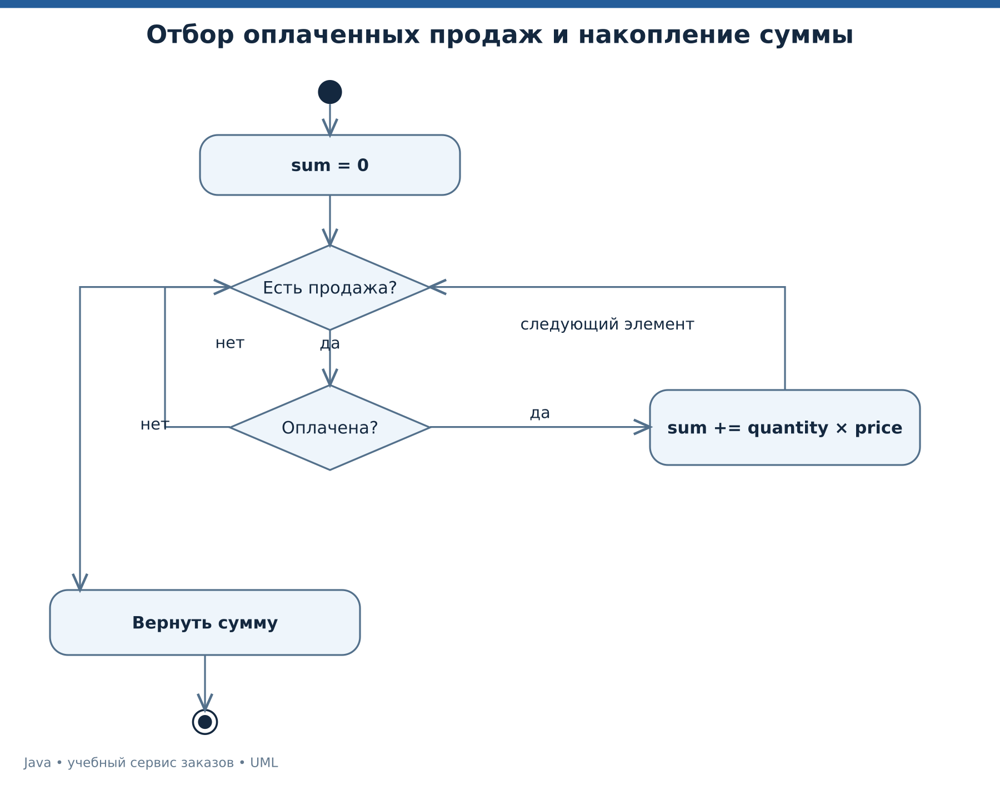

# Лекция 5. Лямбды, функциональные интерфейсы и Stream API

У нас есть проверенный набор продаж. Нужно выбрать оплаченные, посчитать выручку и разложить её по сегментам клиентов. На этой лекции меняется способ выражения обработки, но сохраняются прежние требования к точности, порядку и понятному договору.

[Все лекции](../README.md) · [Текст преподавателя](../speaker-notes/05-functional-streams.md)

## Маршрут занятия

| Блок | Что разбираем |
|---|---|
| [L05-01](#l05-01) | От цикла к описанию преобразования |
| [L05-02](#l05-02) | Лямбда и функциональный интерфейс |
| [L05-03](#l05-03) | Захват переменных и ссылка на метод |
| [L05-04](#l05-04) | Ленивость, терминальная операция и повторное использование |
| [L05-05](#l05-05) | Группировка, сортировка и форма результата |
| [L05-06](#l05-06) | Сведение и условия параллельного вычисления |
| [L05-07](#l05-07) | Запуск отчёта и проверка вручную |
| [L05-08](#l05-08) | Хитрые задачи и границы выразительности |

---

<a id="l05-01"></a>

## L05-01. От цикла к описанию преобразования

Сначала сформулируем запрос обычными словами. Берём только оплаченные продажи. Для каждой вычисляем количество, умноженное на цену. Складываем результаты. Условие оплаченности важно — стоимость незавершённого заказа не входит в выбранный показатель выручки.

Обычный цикл остаётся корректным и понятным решением.

```java
long total = 0;
for (Sale sale : sales) {
    if (sale.paid()) {
        total += sale.total();
    }
}
```

Аналогичный запрос можно выразить последовательностью операций.

```java
long total = sales.stream()
        .filter(Sale::paid)
        .mapToLong(Sale::total)
        .sum();
```

`stream()` создаёт поток элементов, `filter` оставляет нужные, `mapToLong` получает числа, `sum` завершает вычисление итогом. Stream не является коллекцией-хранилищем и не равен потоку выполнения `Thread`. [Stream][STREAM].

Выбор формы в нашем проекте зависит от читаемости. Для линейного преобразования Stream часто удобен. Для сложного изменяемого состояния, ранних выходов с несколькими причинами и подробной пошаговой логики обычный цикл может быть яснее.

В демонстрации цены и количество малы, итог помещается в `long`. `sum()` сам по себе не превращает арифметику в защищённую от переполнения финансовую систему. При другом диапазоне данных потребуются ограничения или другой способ суммирования.



*UML деятельности последовательного вычисления отчёта.* [Исходник UML](../diagrams/05-stream-activity.puml).

Чтобы прочитать ссылки на методы в этой цепочке, сначала разберём, как Java передаёт поведение как значение.

---

<a id="l05-02"></a>

## L05-02. Лямбда и функциональный интерфейс

Функциональный интерфейс имеет один абстрактный метод в смысле правил языка. Он может содержать методы `default` и `static`. Аннотация `@FunctionalInterface` просит компилятор проверить намерение автора. Лямбда получает смысл через целевой тип такого интерфейса. [Функциональные интерфейсы][JLS9], [лямбда-выражения][JLS15].

```java
@FunctionalInterface
interface DiscountPolicy {
    long discount(long gross);
}

DiscountPolicy noDiscount = gross -> 0;
DiscountPolicy fivePercent = gross -> gross / 20;
```

Вместо отдельного класса передали небольшое правило. Тело лямбды не запускается просто от её объявления. Оно будет выполнено, когда потребитель вызовет абстрактный метод.

Стандартные функциональные интерфейсы помогают согласовать обычные формы поведения.

| Интерфейс | Вопрос | Пример |
|---|---|---|
| `Predicate<T>` | Подходит ли объект | Продажа оплачена |
| `Function<T,R>` | Во что преобразовать | Продажу в сегмент |
| `Consumer<T>` | Что сделать с объектом | Передать в журнал |
| `Supplier<T>` | Как получить объект | Создать значение по требованию |

Функция не обязана быть математически чистой только потому, что записана лямбдой. Она может менять внешние объекты или обращаться к сети. Для обработки Stream документация требует учитывать невмешательство в источник и отсутствие нежелательного состояния. [Function][FUNCTION], [Stream][STREAM].

В нашем отчёте преобразования не меняют продажи. Такой выбор облегчает проверку и подготовит данные к безопасному обсуждению параллелизма.

---

<a id="l05-03"></a>

## L05-03. Захват переменных и ссылка на метод

Лямбда может использовать локальную переменную, если она `final` или effectively final — после инициализации не получает нового присваивания. Это ограничение относится к переменной, а не ко всему достижимому объектному состоянию. [Захват локальных переменных][JLS15].

```java
long threshold = 200_000;
Predicate<Sale> expensive = sale -> sale.total() >= threshold;
// threshold = 300_000; // После раскомментирования захват станет недопустимым
```

Если захвачена ссылка на `ArrayList`, запрет переприсваивания ссылки не запрещает изменять список через `add`. Но такие изменения могут осложнить понимание кода и особенно его параллельное выполнение.

Ссылка `Sale::paid` в подходящем контексте обозначает вызов `paid` у переданного объекта продажи. Она соответствует лямбде `sale -> sale.paid()`. Ссылка `Sale::total` аналогична `sale -> sale.total()`. [Ссылки на методы][JLS15].

```java
sales.stream().filter(sale -> sale.paid());
sales.stream().filter(Sale::paid);
```

В показанном фрагменте пока нет терминальной операции, поэтому полного расчёта отчёта не происходит. Оба выражения приведены для чтения синтаксиса.

Ссылки на методы полезны, когда имя само объясняет действие. Если преобразование требует сложной оговорки, иногда лучше вынести его в явно названный метод или оставить читаемую лямбду. Цель — уменьшить количество деталей, которые читатель должен одновременно держать в голове.

---

<a id="l05-04"></a>

## L05-04. Ленивость, терминальная операция и повторное использование

Промежуточные операции Stream обычно ленивы. Терминальная операция запускает нужное вычисление и потребляет поток. Один объект Stream не предназначен для повторного обхода. Для нового запроса создают новый поток от источника. [Stream][STREAM].

```java
var paid = sales.stream().filter(Sale::paid);
long count = paid.count();
// paid.toList(); // Повторное использование недопустимо
```

Ленивость помогает не делать работу, которая не нужна результату. `findFirst`, `anyMatch` и `limit` могут сократить объём обработки при подходящей цепочке. Из этого следует важное ограничение на побочные эффекты.

```java
long count = List.of(1, 2, 3).stream()
        .peek(System.out::println)
        .count();
```

Нельзя строить договор программы на том, что `peek` обязательно выведет каждое число. Реализация вправе оптимизировать вычисление, если размер результата известен без обхода. `peek` не должен быть местом обязательного списания денег или аудита.

В нашей демонстрации для наблюдения используется `mapToInt` и `sum`. Значения нужны итоговой сумме, поэтому последовательный обход показывает три вызова на заданных данных. Это специально подобранный учебный эксперимент, а не универсальное обещание для любого сочетания операций.

Ленивость связана и с ресурсами. Если источник — `Files.lines`, блок `try-with-resources` должен охватывать потребление потока. Нельзя вернуть такой Stream из закрытого блока и затем ожидать успешного чтения файла.

---

<a id="l05-05"></a>

## L05-05. Группировка, сортировка и форма результата

Задача отчёта по сегментам выражается `groupingBy` и downstream-коллектором суммы. В качестве контейнера выбираем `TreeMap`, чтобы ключи печатались в естественном порядке. [Collectors][COLLECTORS].

```java
var bySegment = sales.stream()
        .filter(Sale::paid)
        .collect(Collectors.groupingBy(
                Sale::segment,
                TreeMap::new,
                Collectors.summingLong(Sale::total)
        ));
```

Нужен не список всех продаж внутри каждой группы, а итоговая сумма. Поэтому downstream-операция важна для формы результата. Без неё получится другая структура и другая задача.

Список уникальных артикулов строим отдельным запросом.

```java
var skus = sales.stream()
        .map(Sale::sku)
        .distinct()
        .sorted()
        .toList();
```

`distinct` опирается на равенство элементов. `sorted` добавляет требование упорядочивания и обычно требует накопления данных перед выдачей отсортированного результата. Не стоит добавлять сортировку только ради привычного вида цепочки.

Результат `Stream.toList()` не допускает изменение структуры. А у `Collectors.toList()` документация не гарантирует конкретный тип, изменяемость или потокобезопасность. Если нужен определённый изменяемый контейнер, выбирайте `Collectors.toCollection(ArrayList::new)`. [Stream.toList][STREAM], [Collectors][COLLECTORS].

При `toMap` дублирующий ключ требует решения. Если дубликаты возможны, нужно определить функцию объединения или явно считать их ошибкой. «Сохранить последний» и «сложить значения» означают разные бизнес-правила.

---

<a id="l05-06"></a>

## L05-06. Сведение и условия параллельного вычисления

`reduce` объединяет элементы в одно значение. Для корректного параллельного разбиения важны ассоциативность операции и подходящий нейтральный элемент. Для сложения целых без выхода за допустимый диапазон нейтральный элемент — ноль. Для умножения — единица. [Сведение Stream][STREAM].

Вычитание не ассоциативно. `(10 - 3) - 2 = 5`, а `10 - (3 - 2) = 9`. Поэтому нельзя заменить произвольный последовательный цикл параллельным reduce и ожидать тот же результат.

Даже у математически ассоциативной суммы вычисления с `double` могут зависеть от порядка округлений. Если финансовая модель требует точного результата, важны тип данных, порядок округления и договор расчёта.

Не используем общий `ArrayList` как изменяемый результат внутри `parallelStream().forEach`. Несколько потоков будут менять один объект, а выбор `parallel` не делает его безопасным. Для сбора результата служит подходящий коллектор с оговорённым договором. [Параллельные вычисления и невмешательство][STREAM].

Параллельный Stream в этом курсе не является первым способом ускорить отчёт. Сначала измеряем узкое место, оцениваем объём данных и стоимость операций. Если задача ждёт сеть или БД, вопрос управления ресурсами шире простой замены `stream` на `parallelStream`.

Чистые преобразования облегчают рассуждение, но не гарантируют ускорение. К следующей лекции нужно различать правильность результата, наличие параллелизма и наблюдаемую производительность.

---

<a id="l05-07"></a>

## L05-07. Запуск отчёта и проверка вручную

Откройте [Main.java отчёта](../examples/05-streams/Main.java).

```bash
java tools/Run.java 05
```

```text
PAID_CENTS=625000
SEGMENTS={B2B=300000, B2C=325000}
SKUS=[BOOK, CABLE, HUB]
CALLS_BEFORE=0
SUM=12
CALLS_AFTER=3
REUSE=REJECTED
```

Для оплаченных продаж итог выводится из трёх слагаемых. `2 × 150000 + 1 × 250000 + 3 × 25000 = 625000` копеек. Неоплаченная книга на 150000 копеек исключена фильтром. В B2B осталось 300000 копеек, в B2C `250000 + 75000 = 325000`.

Артикулы собираются из всех продаж, независимо от оплаты. Поэтому отчёт об артикулах и отчёт о выручке имеют разные фильтры. Это явно выбранные запросы, а не случайная несогласованность.

Учебный поток чисел преобразует 1, 2, 3 в 2, 4, 6. Сумма равна 12, число вызовов преобразования равно трём. Повторное потребление того же объекта потока отклоняется.

Эксперимент — временно убрать фильтр оплаты и предсказать изменение. Общая сумма станет 775000, сумма B2B — 450000. Сначала назовите эти числа, затем запускайте. После эксперимента восстановите код, чтобы эталонный сценарий продолжал совпадать с документацией.

---

<a id="l05-08"></a>

## L05-08. Хитрые задачи и границы выразительности

Задача 1. Обязана ли цепочка `stream().peek(...).count()` вызвать наблюдающее действие для каждого элемента списка? Можно ли записывать там обязательное событие аудита?

Задача 2. Почему вызов `result.add(...)` после `Stream.toList()` может завершиться исключением, хотя тип переменной — `List`?

Задача 3. Можно ли захватить `final List<String>` в лямбде и затем вызвать `add`? Делает ли слово `final` такую операцию безопасной для нескольких потоков?

Задача 4. Разработчик заменил цикл вычисления скидок на `parallelStream`, сохранив изменение общей переменной. Какой договор он должен проверить до обсуждения скорости?

Ответы — в [L05-08](../speaker-notes/05-functional-streams.md#l05-08). Опорные источники — [Stream][STREAM], [лямбды][JLS15], [модель памяти][JLS17].

Самостоятельное продолжение — добавить отчёт по артикулу только для оплаченных продаж. Для каждого артикула нужны количество проданных единиц и сумма. Сначала запишите ожидаемый ответ на текущих четырёх строках, затем определите форму результирующего значения и только после этого выбирайте коллектор.

Мы научились передавать поведение и собирать преобразования. Теперь можно осмысленно перейти к нескольким потокам исполнения и увидеть, какие привычные действия перестают быть безопасными при пересечении во времени.

[Следующая лекция](./06-concurrency.md)


## Официальные источники

[JLS9]: https://docs.oracle.com/javase/specs/jls/se25/html/jls-9.html "JLS 25, глава 9 — интерфейсы и аннотации"
[JLS15]: https://docs.oracle.com/javase/specs/jls/se25/html/jls-15.html "JLS 25, глава 15 — выражения и вызовы методов"
[JLS17]: https://docs.oracle.com/javase/specs/jls/se25/html/jls-17.html "JLS 25, глава 17 — потоки, блокировки и модель памяти"
[FUNCTION]: https://docs.oracle.com/en/java/javase/25/docs/api/java.base/java/util/function/Function.html "Java SE 25 API — Function"
[STREAM]: https://docs.oracle.com/en/java/javase/25/docs/api/java.base/java/util/stream/Stream.html "Java SE 25 API — Stream"
[COLLECTORS]: https://docs.oracle.com/en/java/javase/25/docs/api/java.base/java/util/stream/Collectors.html "Java SE 25 API — Collectors"

- [JLS 25, глава 9 — интерфейсы и аннотации][JLS9]
- [JLS 25, глава 15 — выражения и вызовы методов][JLS15]
- [JLS 25, глава 17 — потоки, блокировки и модель памяти][JLS17]
- [Java SE 25 API — Function][FUNCTION]
- [Java SE 25 API — Stream][STREAM]
- [Java SE 25 API — Collectors][COLLECTORS]
