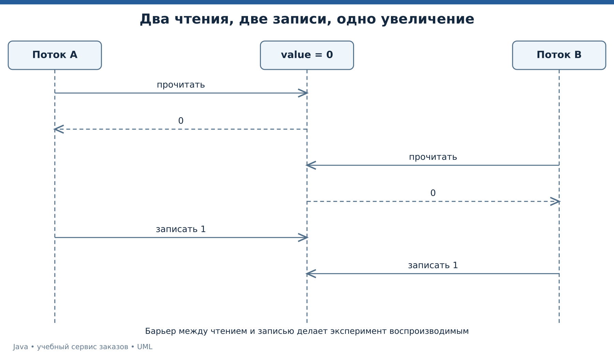
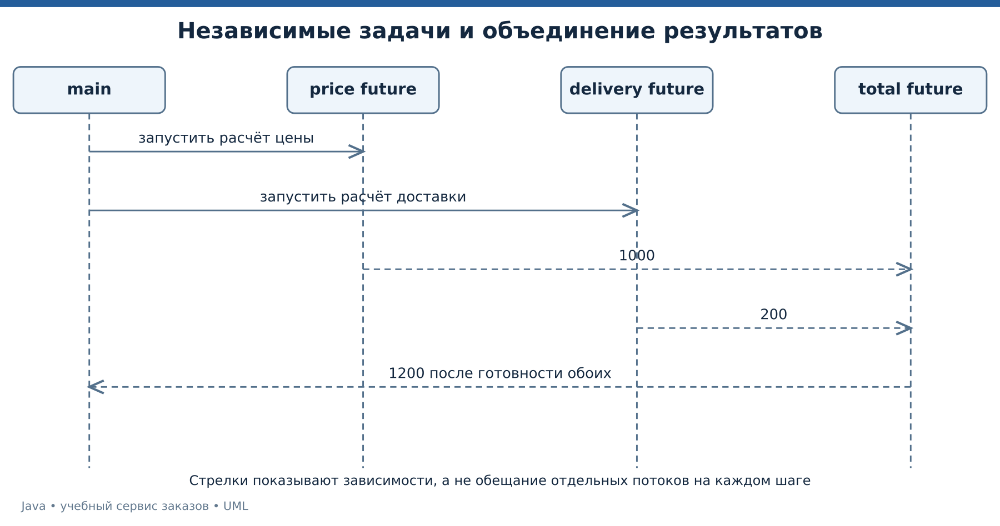

# Лекция 6. Многопоточность, асинхронность и современные средства Java

До сих пор примеры в основном выполняли один понятный путь последовательно. Теперь два покупателя одновременно пытаются забрать последний товар. Разберём корректность общей памяти, управление задачами и границы обещаний виртуальных потоков.

[Все лекции](../README.md) · [Текст преподавателя](../speaker-notes/06-concurrency.md)

## Маршрут занятия

| Блок | Что разбираем |
|---|---|
| [L06-01](#l06-01) | Конкурентность и общий изменяемый объект |
| [L06-02](#l06-02) | Видимость, volatile и happens-before |
| [L06-03](#l06-03) | AtomicInteger и критическая секция |
| [L06-04](#l06-04) | ExecutorService и жизненный цикл задач |
| [L06-05](#l06-05) | CompletableFuture, объединение и тайм-аут |
| [L06-06](#l06-06) | Виртуальные потоки и ScopedValue в Java 25 |
| [L06-07](#l06-07) | Воспроизводимый эксперимент и реальный инженерный кейс |
| [L06-08](#l06-08) | Задачи о повторе, очереди и атомарности |

---

<a id="l06-01"></a>

## L06-01. Конкурентность и общий изменяемый объект

Конкурентные задачи могут продвигаться с чередованием. Параллельные задачи фактически выполняются одновременно на доступных вычислительных ресурсах. Наличие нескольких потоков не гарантирует ускорения конкретного вычисления.

Опасный участок возникает, когда несколько задач читают и изменяют одно состояние, а нужного порядка и атомарности нет. Рассмотрим операцию `value++`. На уровне смысла она читает значение, вычисляет следующее и записывает его. Одного внешне короткого выражения недостаточно для атомарного договора. [Модель памяти и потоки][JLS17].

Если начальное значение равно нулю, возможен следующий порядок.

| Шаг | Поток A | Поток B |
|---|---|---|
| 1 | Читает 0 | |
| 2 | | Читает 0 |
| 3 | Записывает 1 | |
| 4 | | Записывает 1 |

Выполнены две попытки увеличения, а итог равен одному. Этот результат не означает, что компьютер забыл арифметику. Программа разрешила такое чередование операций.



*UML последовательности потери одного обновления.* [Исходник UML](../diagrams/06-lost-update.puml).

В демонстрации барьер специально заставляет оба потока закончить чтение до начала записи. Поэтому проблема видна стабильно, без зависимости от случайного удачного запуска. Это модель конкретного небезопасного чередования, а не измерение его вероятности в обычной программе.

---

<a id="l06-02"></a>

## L06-02. Видимость, volatile и happens-before

Модель памяти задаёт, какие отношения между действиями позволяют рассуждать о видимости значений. `happens-before` — отношение, а не простая догадка по времени на часах. Освобождение монитора и последующее захватывание того же монитора, а также запись и последующее чтение соответствующей volatile-переменной участвуют в правилах видимости. [JLS, happens-before][JLS17].

`volatile` полезен для согласованного наблюдения отдельного значения при соблюдении договора доступа. Но `volatile int value` не делает составную операцию `value++` атомарной. В нашем сломанном счётчике поле специально объявлено volatile — ошибка остаётся.

```java
volatile int value;

void increment() {
    int snapshot = value;
    // Другой поток успевает прочитать прежнее значение.
    value = snapshot + 1;
}
```

`Thread.sleep` не является способом обеспечить нужное отношение видимости и не заменяет синхронизацию. Задержка может случайно изменить порядок выполнения, но не создать требуемый договор корректности.

Неизменяемые значения и отказ от общего изменяемого состояния упрощают программу. Например, каждый поток может вычислить собственный результат, а один владелец затем объединит результаты. Это проектный способ уменьшить число опасных взаимодействий, а не универсальный отказ от синхронизации.

Для счётчика дальше применим атомарную операцию. Для нескольких связанных полей потребуется более широкая граница защиты.

---

<a id="l06-03"></a>

## L06-03. AtomicInteger и критическая секция

`AtomicInteger.incrementAndGet` выполняет атомарное увеличение одного счётчика. Для этой узкой задачи он выражает нужный договор напрямую. [AtomicInteger][ATOMIC].

```java
var counter = new AtomicInteger();
counter.incrementAndGet();
```

Но резервирование товара связано с условием. Нужно проверить остаток и уменьшить его только при наличии товара. Если эти действия отдельно защищены, между ними всё ещё может вклиниться другой поток.

```java
static final class Stock {
    private int available = 1;
    synchronized boolean reserve() {
        if (available == 0) return false;
        available--;
        return true;
    }
}
```

Здесь весь предметный переход защищён одним монитором экземпляра `Stock`. Все обращения, которые участвуют в том же инварианте, должны соблюдать согласованный способ защиты. [Мониторы и synchronized][JLS17].

Наличие `ConcurrentHashMap` не делает автоматически атомарным сценарий из проверки остатка, добавления заказа и сохранения ключа повтора. Структура защищает свои операции по собственному договору, а бизнес-сценарий может охватывать несколько таких операций и несколько структур.

В финальном примере одна синхронизированная операция хранилища объединит проверку ключа, резерв и сохранение заказа в памяти одного процесса. Для нескольких процессов понадобится общий внешний механизм согласования, например транзакция БД с подходящими ограничениями.

Не удерживайте блокировку дольше, чем требует инвариант. Сетевое ожидание внутри общей критической секции может задержать все остальные запросы к этому объекту.

---

<a id="l06-04"></a>

## L06-04. ExecutorService и жизненный цикл задач

Поток — ресурс выполнения, задача — работа, которую нужно выполнить. `ExecutorService` отделяет отправку задачи от управления потоками. `submit` возвращает `Future`, через который можно получить результат или узнать об ошибке. [ExecutorService][EXECUTOR].

```java
ExecutorService pool = Executors.newFixedThreadPool(2);
try {
    Future<Integer> result = pool.submit(() -> 42);
    System.out.println(result.get(2, TimeUnit.SECONDS));
} finally {
    pool.shutdownNow();
    pool.awaitTermination(5, TimeUnit.SECONDS);
}
```

Это фрагмент с соответствующими импортами и обработкой объявленных исключений. В полном примере метод `main` их объявляет, чтобы сосредоточиться на устройстве задач.

`shutdownNow` пытается прервать выполняемые задачи и возвращает ещё не начатые. Это не принудительное безопасное убийство любого Java-кода. Задача должна сотрудничать с прерыванием и иметь конечные внешние ожидания. Если перехватили `InterruptedException` и не передаёте его выше, обычно восстанавливают флаг через `Thread.currentThread().interrupt()`.

Фиксированный пул ограничивает число потоков, но `newFixedThreadPool` не задаёт малую ограниченную очередь ожидающих задач. Для известного числа демонстрационных задач это приемлемо. Для неконтролируемого входного потока нужен отдельный договор очереди, отказа и ограничения нагрузки.

В коде совместимости с Java 17 закрытие оформлено явно. В современных версиях `ExecutorService` также имеет договор `AutoCloseable`, но этот дополнительный API не используется в основном маршруте.

---

<a id="l06-05"></a>

## L06-05. CompletableFuture, объединение и тайм-аут

`CompletableFuture` позволяет связать получение результата с последующей обработкой. В примере цена и доставка вычисляются независимо, затем складываются. [CompletableFuture][FUTURE].

```java
var price = CompletableFuture.supplyAsync(() -> 1000, pool);
var delivery = CompletableFuture.supplyAsync(() -> 200, pool);
var total = price.thenCombine(delivery, Integer::sum)
        .orTimeout(2, TimeUnit.SECONDS);
System.out.println(total.join());
```

`thenApply` преобразует готовое значение. `thenCompose` связывает шаг, который сам возвращает будущий результат. `thenCombine` объединяет два результата. `join` при проблеме использует unchecked-обёртку, а `get` имеет объявленные checked-исключения. Выбор зависит от договора вызывающего кода.

Методы без суффикса `Async` могут выполняться в потоке, который завершает предыдущий этап, или в другом вызывающем контексте по договору API. Не стоит предполагать отдельный поток для каждого звена цепочки. Когда место выполнения важно, используйте явный executor у подходящих async-операций.

`orTimeout` завершает future исключением по истечении ожидания, но не гарантирует отмену уже выполняющегося внешнего действия. Если удалённый платёж состоялся после нашего тайм-аута, повтор без ключа идемпотентности может быть опасен для бизнес-смысла.



*UML последовательности независимых расчётов и объединения результата.* [Исходник UML](../diagrams/06-future-sequence.puml).

В демонстрации нет реальных сетевых задержек, поэтому `1200` — результат функциональной связи, а не доказательство ускорения. Числа получены как `1000 + 200`.

---

<a id="l06-06"></a>

## L06-06. Виртуальные потоки и ScopedValue в Java 25

Виртуальные потоки предназначены прежде всего для масштабирования большого числа задач, значительную часть времени ожидающих ввод-вывод. Они не делают отдельное вычисление арифметики быстрее и не отменяют ограничений внешних систем. [Руководство виртуальных потоков][VIRTUAL].

Дополнительный [ModernConcurrency.java](../examples/06-concurrency/bonus25/ModernConcurrency.java) требует JDK 25, потому что использует `ScopedValue`. Область значения привязана к выполнению конкретного блока, а не к произвольному глобальному изменяемому состоянию. [ScopedValue][SCOPED].

```java
try (var executor = Executors.newVirtualThreadPerTaskExecutor()) {
    var task = executor.submit(() ->
        ScopedValue.where(REQUEST, "demo-42").call(() -> REQUEST.get())
    );
    System.out.println(task.get());
}
```

Полный файл дополнительно использует `Semaphore`. В нём только одна задача, поэтому семафор показывает форму ограничения, а не измеряет конкуренцию. При большом числе запросов таким механизмом можно ограничить доступ к конкретному дефицитному ресурсу. Сами соединения с БД не станут безграничными от использования виртуальных потоков.

```bash
java tools/Run.java bonus25
```

Команда выполняет также пример native memory из лекции 8. Дополнительные программы не используют preview-возможности. В доступной среде подготовки был только JDK 17, поэтому дополнительные файлы сверены с API Java 25, но их фактический запуск в этой среде не подтверждён. Основные восемь демонстраций от них не зависят.

Для домашней подготовки преподавателя — установить JDK 25, запустить эту команду заранее и сверить `VIRTUAL=true REQUEST=demo-42` и `NATIVE_VALUE=42`.

---

<a id="l06-07"></a>

## L06-07. Воспроизводимый эксперимент и реальный инженерный кейс

Основной сценарий работает без дополнительных библиотек.

```bash
java tools/Run.java 06
```

```text
BROKEN=1
ATOMIC=2
RESERVED=1
QUOTE=1200
```

Два чтения нуля и две записи единицы дают `BROKEN=1`. Два атомарных увеличения дают `ATOMIC=2`. Из двух запросов к единственной единице товара проходит один. Цена 1000 и доставка 200 дают 1200. Это результаты фиксированных экспериментов, а не статистика производительности.

**Подтверждённый кейс Netflix.** В инженерной публикации 29 июля 2024 года команда разобрала зависание при использовании виртуальных потоков в Java 21. Для поиска причины сопоставляли дампы потоков и памяти. В описанном сценарии ожидавший поток не получал доступного carrier-потока, а другие удерживали их в состоянии pinning. [Первичный разбор Netflix][NETFLIX].

Методический вывод для нашего курса — сложный сбой нужно объяснять конкретным порядком ожиданий и владения ресурсами. Это наша интерпретация опубликованного расследования. Статья относится к Java 21 того периода; она не является перечнем всех ограничений Java 25. Текущие правила сверяем в [документации выбранного JDK][VIRTUAL].

В отладке сначала собираем наблюдения, затем строим гипотезу, после чего проверяем её на упрощённом сценарии. Добавление произвольного `sleep` без объяснения не превращает гонку в исправленную программу.

---

<a id="l06-08"></a>

## L06-08. Задачи о повторе, очереди и атомарности

Задача 1. Поле остатка объявлено volatile. Два потока отдельно проверяют `available > 0` и затем уменьшают остаток. Может ли один и тот же последний товар быть обещан двум покупателям?

Задача 2. После `future.orTimeout(...)` клиент получил ошибку. Доказывает ли это, что удалённый сервис не выполнил действие?

Задача 3. Пул содержит четыре потока. Может ли приложение накопить тысячу ожидающих задач? Какая политика нужна помимо числа потоков?

Задача 4. Два экземпляра сервиса используют одинаковый synchronized-метод, но каждый хранит собственный остаток в памяти. Защищён ли общий реальный склад от двойной продажи?

Ответы — в [L06-08](../speaker-notes/06-concurrency.md#l06-08). Основания — [JLS][JLS17], [ExecutorService][EXECUTOR], [CompletableFuture][FUTURE].

Продолжение — сформулировать контракт атомарного `place`. Он должен связать проверку повтора, проверку наличия, уменьшение остатка и сохранение заказа. Напишите сначала последовательность и точки отказа. Следующая лекция покажет, как этот договор проходит через сеть и транзакцию базы данных.

[Следующая лекция](./07-http-jdbc.md)


## Официальные источники

[JLS17]: https://docs.oracle.com/javase/specs/jls/se25/html/jls-17.html "JLS 25, глава 17 — потоки, блокировки и модель памяти"
[EXECUTOR]: https://docs.oracle.com/en/java/javase/25/docs/api/java.base/java/util/concurrent/ExecutorService.html "Java SE 25 API — ExecutorService"
[ATOMIC]: https://docs.oracle.com/en/java/javase/25/docs/api/java.base/java/util/concurrent/atomic/AtomicInteger.html "Java SE 25 API — AtomicInteger"
[FUTURE]: https://docs.oracle.com/en/java/javase/25/docs/api/java.base/java/util/concurrent/CompletableFuture.html "Java SE 25 API — CompletableFuture"
[VIRTUAL]: https://docs.oracle.com/en/java/javase/25/core/virtual-threads.html "JDK 25 Core Libraries — Virtual Threads"
[SCOPED]: https://docs.oracle.com/en/java/javase/25/docs/api/java.base/java/lang/ScopedValue.html "Java SE 25 API — ScopedValue"
[NETFLIX]: https://netflixtechblog.com/java-21-virtual-threads-dude-wheres-my-lock-3052540e231d "Netflix TechBlog — Java 21 Virtual Threads, 29 июля 2024"

- [JLS 25, глава 17 — потоки, блокировки и модель памяти][JLS17]
- [Java SE 25 API — ExecutorService][EXECUTOR]
- [Java SE 25 API — AtomicInteger][ATOMIC]
- [Java SE 25 API — CompletableFuture][FUTURE]
- [JDK 25 Core Libraries — Virtual Threads][VIRTUAL]
- [Java SE 25 API — ScopedValue][SCOPED]
- [Netflix TechBlog — Java 21 Virtual Threads, 29 июля 2024][NETFLIX]
