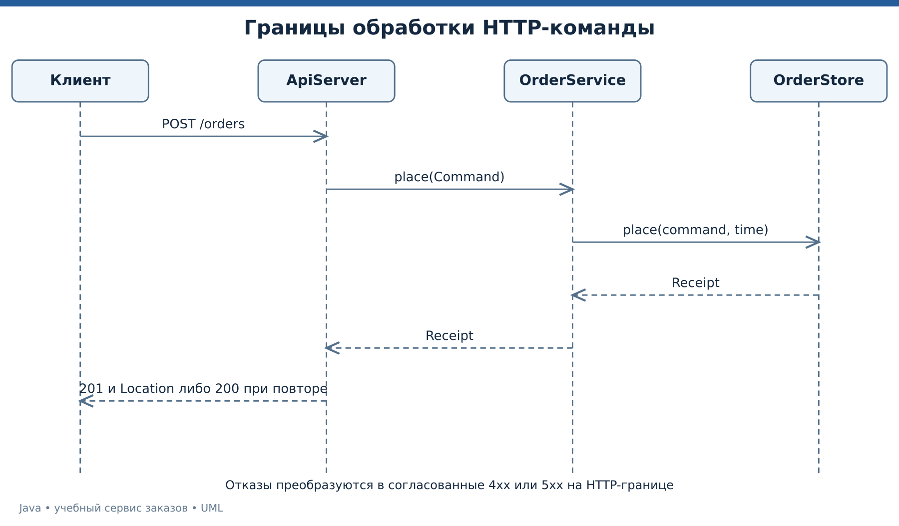
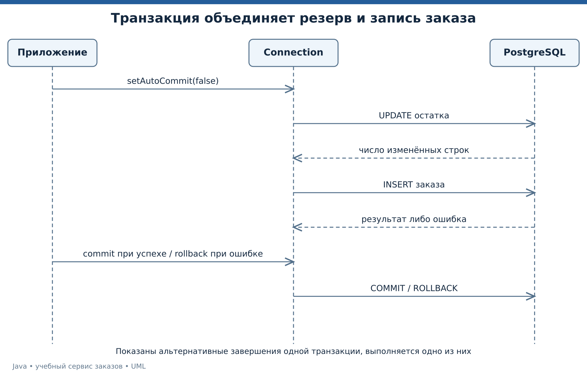

# Лекция 7. HTTP, JDBC и согласованность данных

Заказ выходит за пределы одного процесса. Клиент отправляет запрос по сети, сервер проверяет команду, а база данных хранит результат. Научимся различать успешный транспорт, успешное бизнес-действие и подтверждённое сохранение.

[Все лекции](../README.md) · [Текст преподавателя](../speaker-notes/07-http-jdbc.md)

## Маршрут занятия

| Блок | Что разбираем |
|---|---|
| [L07-01](#l07-01) | Граница приложения и разделение обязанностей |
| [L07-02](#l07-02) | Метод, адрес, статус и тело ответа |
| [L07-03](#l07-03) | HttpClient и локальная воспроизводимая сеть |
| [L07-04](#l07-04) | JDBC, драйвер и параметризованный запрос |
| [L07-05](#l07-05) | Транзакция объединяет связанные изменения |
| [L07-06](#l07-06) | Ограничения БД и конкурентное оформление |
| [L07-07](#l07-07) | Подготовка JDBC-демонстрации |
| [L07-08](#l07-08) | Задачи о границах системы |

---

<a id="l07-01"></a>

## L07-01. Граница приложения и разделение обязанностей

HTTP-обработчик получает байты и сведения о запросе. Предметный сценарий принимает проверенную команду. Хранилище отвечает за выполнение своего договора данных. Это выбранная архитектура нашего учебного сервиса, позволяющая отдельно проверять расчёты, транспорт и сохранение.

Сквозной путь выглядит следующим образом.

1. Разобрать запрос и проверить формат полей.
2. Создать команду с предметными ограничениями.
3. Выполнить сценарий через интерфейс хранилища.
4. Преобразовать успех или отказ в HTTP-ответ.

Между этапами нельзя терять смысл. Ошибка разбора количества не равна отсутствию товара. Отсутствие товара не равно недоступности БД. Для пользователя все три ситуации могут означать невозможность оформить заказ, но дальнейшие действия различаются.



*UML последовательности обработки запроса через границы приложения.* [Исходник UML](../diagrams/07-http-sequence.puml).

В финальном примере внешний формат команды — `application/x-www-form-urlencoded`, ответ — JSON с небольшим фиксированным набором полей. Выбор формы запроса сделан ради запуска средствами стандартного JDK. Это не требование использовать форму в любом современном API.

Показанный HTTP API использует ресурсы заказов и согласованные методы, но короткая демонстрация не претендует на полное изложение архитектурного стиля REST. Здесь учимся точному договору запросов и ответов. [Семантика HTTP][HTTP].

---

<a id="l07-02"></a>

## L07-02. Метод, адрес, статус и тело ответа

HTTP-запрос содержит метод, целевой адрес, заголовки и при необходимости тело. Ответ сообщает статус, заголовки и представление результата. Коды нельзя выбирать только ради того, чтобы клиент перестал показывать ошибку. [RFC 9110][HTTP].

В учебном контракте используем следующую таблицу.

| Ситуация | Статус | Поведение |
|---|---|---|
| Создан новый заказ | `201` | Возвращаются данные и `Location` |
| Узнан повтор прежней команды | `200` | Возвращается прежний заказ |
| Некорректная команда | `400` | Действие не принято |
| Не найден ресурс или товар | `404` | Нет требуемого объекта |
| Метод не разрешён | `405` | Указывается `Allow` |
| Конфликт ключа или недостаток остатка | `409` | Нарушен текущий договор состояния |
| Тело больше лимита | `413` | Тело не принимается |
| Неподдержанный тип содержимого | `415` | Нужен другой формат |
| Непредвиденный серверный сбой | `500` | Подробности остаются в диагностике |

Выбор `409` для нехватки остатка — решение данного API, которое клиент должен знать. RFC не назначает за разработчика все коды каждому бизнес-сценарию.

Для `GET /health` в примере подтверждаем только работоспособность обработчика. Это не полноценная проверка доступности базы данных и всех зависимостей. Проверка готовности обслуживать реальные запросы требует отдельного договора.

Не сериализуем произвольный пользовательский текст конкатенацией строк в JSON. В учебном ответе текстовые поля ограничены закрытым форматом артикула и идентификатора. Для произвольных данных нужен корректный сериализатор и согласованная схема ответа.

---

<a id="l07-03"></a>

## L07-03. HttpClient и локальная воспроизводимая сеть

Встроенный `HttpClient` умеет отправлять синхронные и асинхронные запросы. Конфигурация клиента и запросов задаёт нужные ограничения ожидания. Клиент пригоден для повторного использования. [HttpClient][HTTPCLIENT].

```java
var client = HttpClient.newBuilder()
        .connectTimeout(Duration.ofSeconds(2))
        .build();
var request = HttpRequest.newBuilder(uri)
        .timeout(Duration.ofSeconds(3))
        .GET()
        .build();
var response = client.send(request, HttpResponse.BodyHandlers.ofString());
```

Тайм-аут соединения и тайм-аут запроса относятся к разным этапам. Успешное получение ответа ещё не означает успешное предметное действие. Нужно проверить статус и договор тела.

Демонстрация [07-integration/Main.java](../examples/07-integration/Main.java) сама запускает сервер на свободном локальном порту, делает два запроса и завершает сервер с executor. Внешний интернет ей не нужен. `HttpServer` находится в модуле JDK `jdk.httpserver` и представляет небольшой встроенный сервер, а не готовую промышленную платформу. [HttpServer][HTTPSERVER].

```bash
java tools/Run.java 07
```

```text
HTTP=200
BODY={"totalCents":120000}
POST=405
```

Второй запрос намеренно использует неподдержанный метод. Он показывает, что установленное соединение может корректно доставить отказ. Проверяется и точный путь — обработчик контекста по префиксу не должен случайно принять любой похожий адрес.

Внешние интеграции добавляют DNS, сертификаты, прокси, аутентификацию и доступность удалённой стороны. Локальная демонстрация изолирует основной договор HTTP, чтобы эти дополнительные факторы не мешали первому разбору.

---

<a id="l07-04"></a>

## L07-04. JDBC, драйвер и параметризованный запрос

JDBC — API Java для работы с источниками данных через драйвер. Интерфейсы `Connection`, `PreparedStatement`, `ResultSet` находятся в платформе, но конкретный драйвер PostgreSQL поставляется отдельно. Сервер БД также является отдельным процессом. [Connection][CONNECTION], [установка pgJDBC][PGJDBC].

`PreparedStatement` позволяет передавать значения параметров отдельно от текста SQL.

```java
try (var update = connection.prepareStatement(
        "UPDATE course_stock SET available = available - ? WHERE sku = ? AND available >= ?")) {
    update.setInt(1, quantity);
    update.setString(2, sku);
    update.setInt(3, quantity);
    int affected = update.executeUpdate();
}
```

Параметры нумеруются с единицы. Значение пользователя не склеивается с SQL-командой. Имена таблиц и столбцов таким способом обычно не параметризуются — для динамической структуры запроса требуется отдельный контролируемый выбор. [PreparedStatement][PREPARED].

Число изменённых строк имеет предметный смысл. Если обновлено 0, мы не можем объявить успешное резервирование. Условие в SQL объединяет проверку достаточного остатка и уменьшение в одну операцию над строкой. Конкретное конкурентное поведение определяется СУБД и уровнем изоляции. Для PostgreSQL разбираем [Read Committed][PGISO].

Ресурсы запроса и результата закрываются через `try-with-resources`. Пароль не входит в исходный файл. В примере соединение получает настройки из переменных окружения, а код не выводит строку подключения с учётными данными в журнал.

Полный отдельный пример находится в [JdbcDemo.java](../examples/07-integration/JdbcDemo.java), структура таблиц — в [schema.sql](../examples/07-integration/schema.sql).

---

<a id="l07-05"></a>

## L07-05. Транзакция объединяет связанные изменения

Оформление должно уменьшить остаток и создать заказ согласованно. Если первая запись изменилась, а вторая не появилась, система получила незавершённый предметный результат. Транзакция позволяет подтвердить или откатить связанные изменения в пределах её договора. [Connection.commit и rollback][CONNECTION].

В отдельном JDBC-примере создаём собственное соединение, проверяем начальный `autoCommit`, затем начинаем транзакционный участок.

```java
connection.setAutoCommit(false);
try {
    reserveStock(connection);
    insertOrder(connection);
    connection.commit();
} catch (SQLException | RuntimeException e) {
    try {
        connection.rollback();
    } catch (SQLException rollbackError) {
        e.addSuppressed(rollbackError);
    }
    throw e;
}
```

Это схема управления, а не отдельный компилируемый файл с готовыми `reserveStock` и `insertOrder`. Полная реализация раскрывает оба SQL-действия в [JdbcDemo.java](../examples/07-integration/JdbcDemo.java).



*UML последовательности подтверждения и отката транзакции.* [Исходник UML](../diagrams/07-transaction.puml).

Если `commit` завершился сетевой ошибкой, клиент не всегда знает, успел ли сервер БД подтвердить транзакцию. Слепой повтор команды остаётся отдельной проблемой. Транзакция и идемпотентность дополняют друг друга.

Соединение в нашем примере принадлежит одному вызову и закрывается после него. Мы не возвращаем его в пул в неизвестном состоянии. При использовании пула границы транзакции и восстановление состояния соединения должны соответствовать договору выбранного механизма управления.

---

<a id="l07-06"></a>

## L07-06. Ограничения БД и конкурентное оформление

Даже корректный Java-код может перестать быть единственным писателем данных. Другой сервис, миграция или административный сценарий тоже способны изменить таблицу. Поэтому важные инварианты, которые выражаются в схеме, закрепляем ограничениями БД. [PostgreSQL constraints][PGCONSTRAINT].

В отдельном примере артикул является первичным ключом склада, количество заказа положительно, остаток неотрицателен, а заказ ссылается на существующий товар. Эти ограничения не заменяют понятную валидацию приложения, но защищают само хранилище.

В финальном адаптере `JdbcOrderStore` ключ команды хранится в уникальном поле `request_key`. Если два одинаковых запроса конкурируют, только одна строка с таким ключом может быть вставлена. При `READ COMMITTED` последующее чтение выполняется в новом снимке оператора и может получить уже завершённый результат победившей транзакции. [Изоляция PostgreSQL][PGISO].

Для совпавшего ключа сравниваем также содержимое команды. Один и тот же ключ с другим количеством — конфликт, а не разрешение вернуть чужой по смыслу результат.

Уровень изоляции нужно выбирать вместе с конкретным алгоритмом. Названия ACID и SERIALIZABLE не освобождают от обработки ошибок и повторов. Разные сценарии имеют разные требования к чтению, блокировкам и допустимым конфликтам.

Внешнюю отправку письма нельзя автоматически включить в ту же локальную транзакцию простым размещением вызова между SQL-командами. Для надёжной связи данных и сообщения нужен отдельный проектный механизм, например сохраняемое событие с последующей доставкой. В данном учебном сервисе отправки сообщений нет.

---

<a id="l07-07"></a>

## L07-07. Подготовка JDBC-демонстрации

Основной HTTP-пример уже запускается без БД. JDBC — отдельная дополнительная демонстрация. Ей нужны PostgreSQL, созданная учебная база и драйвер pgJDBC. Используйте [официальную инструкцию драйвера][PGJDBC] и [порядок подготовки](../docs/JDBC-LAB.md).

Последовательность для самостоятельной подготовки преподавателя следующая.

1. Создать отдельную учебную базу и пользователя с правами на её таблицы.
2. Выполнить `examples/07-integration/schema.sql` в этой базе.
3. Поместить официальный JDBC-драйвер в `lib/postgresql.jar`.
4. Задать `COURSE_JDBC_URL`, `COURSE_JDBC_USER`, `COURSE_JDBC_PASSWORD`.
5. Собрать примеры командой `java tools/Run.java 07`.

Linux и macOS используют двоеточие как разделитель classpath.

```bash
java -cp "build/07:lib/postgresql.jar" JdbcDemo
```

Windows использует точку с запятой.

```powershell
java -cp "build/07;lib/postgresql.jar" JdbcDemo
```

Первый успешный вызов уменьшает исходный остаток 5 на 1 и создаёт один заказ. Повторные вызовы имеют новые ключи и продолжают расходовать остаток. `schema.sql` не восстанавливает запас при повторном запуске, поскольку использует `ON CONFLICT DO NOTHING`.

В среде подготовки код JDBC скомпилирован, но живое соединение с PostgreSQL не проверено — сервер и драйвер отсутствовали. Поэтому `TRANSACTION=COMMITTED` описывает ожидаемый результат после локальной подготовки, а не выданный за факт результат проведённого испытания.

---

<a id="l07-08"></a>

## L07-08. Задачи о границах системы

Задача 1. Клиент получил `200`, но тело содержит поле `error`. Можно ли считать контракт ясным, если успешный и неуспешный исходы документированы одинаково?

Задача 2. `SELECT available`, затем отдельный `UPDATE available = oldValue - quantity`. Почему две параллельные транзакции могут потерять обновление? Чем полезно условное уменьшение в самом UPDATE?

Задача 3. Пользователь повторил команду после тайм-аута. Почему недостаточно просто выдать новый идентификатор заказа?

Задача 4. Разработчик выполнил `commit`, затем отправил письмо. Процесс упал между этими действиями. Какое обещание нарушено, если интерфейс уже говорил о гарантированной отправке?

Ответы — в [L07-08](../speaker-notes/07-http-jdbc.md#l07-08). Основания для анализа — [HTTP][HTTP], [Connection][CONNECTION], [изоляция PostgreSQL][PGISO].

Перед финальной лекцией нарисуйте границу одной команды оформления. Укажите проверки, изменения состояния, успешный результат, возможный повтор и предел атомарности. Следующий шаг — собрать эти решения в проект с пакетами, тестами, сборкой JAR и понятным сценарием запуска.

[Следующая лекция](./08-professional-service.md)


## Официальные источники

[HTTPCLIENT]: https://docs.oracle.com/en/java/javase/25/docs/api/java.net.http/java/net/http/HttpClient.html "Java SE 25 API — HttpClient"
[HTTPSERVER]: https://docs.oracle.com/en/java/javase/25/docs/api/jdk.httpserver/com/sun/net/httpserver/HttpServer.html "JDK 25 API — HttpServer"
[CONNECTION]: https://docs.oracle.com/en/java/javase/25/docs/api/java.sql/java/sql/Connection.html "Java SE 25 API — Connection"
[PREPARED]: https://docs.oracle.com/en/java/javase/25/docs/api/java.sql/java/sql/PreparedStatement.html "Java SE 25 API — PreparedStatement"
[HTTP]: https://www.rfc-editor.org/rfc/rfc9110.html "IETF RFC 9110 — HTTP Semantics"
[PGISO]: https://www.postgresql.org/docs/17/transaction-iso.html "PostgreSQL 17 — Transaction Isolation"
[PGCONSTRAINT]: https://www.postgresql.org/docs/17/ddl-constraints.html "PostgreSQL 17 — Constraints"
[PGJDBC]: https://jdbc.postgresql.org/documentation/setup/ "PostgreSQL JDBC Driver — Getting Started"

- [Java SE 25 API — HttpClient][HTTPCLIENT]
- [JDK 25 API — HttpServer][HTTPSERVER]
- [Java SE 25 API — Connection][CONNECTION]
- [Java SE 25 API — PreparedStatement][PREPARED]
- [IETF RFC 9110 — HTTP Semantics][HTTP]
- [PostgreSQL 17 — Transaction Isolation][PGISO]
- [PostgreSQL 17 — Constraints][PGCONSTRAINT]
- [PostgreSQL JDBC Driver — Getting Started][PGJDBC]
