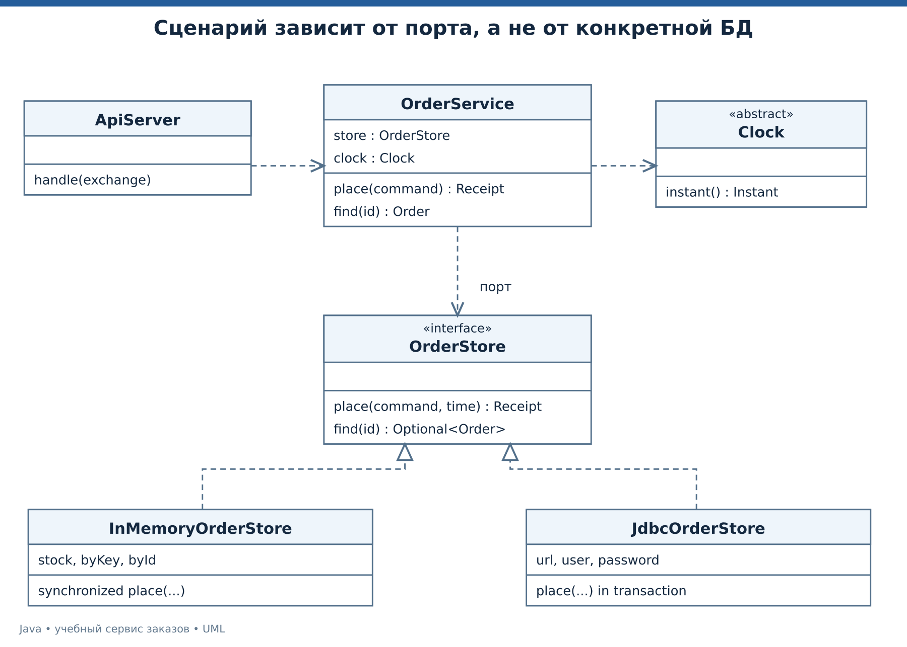
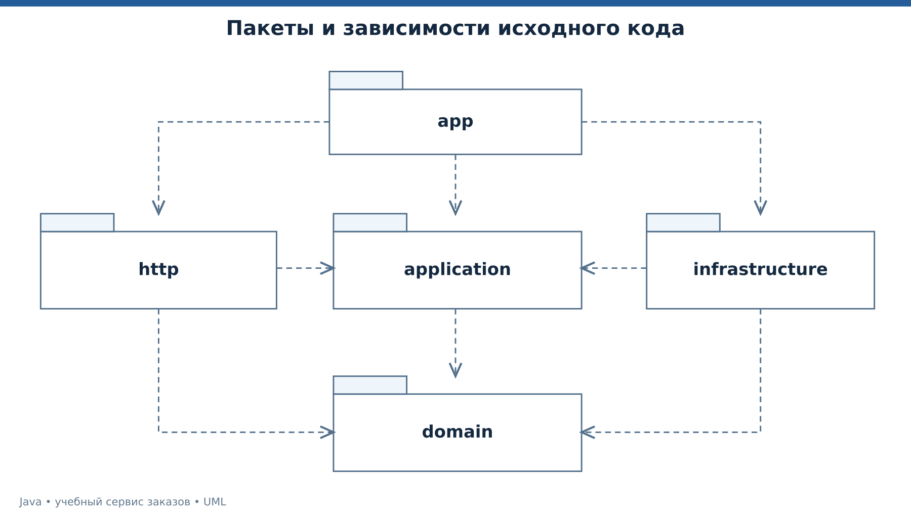
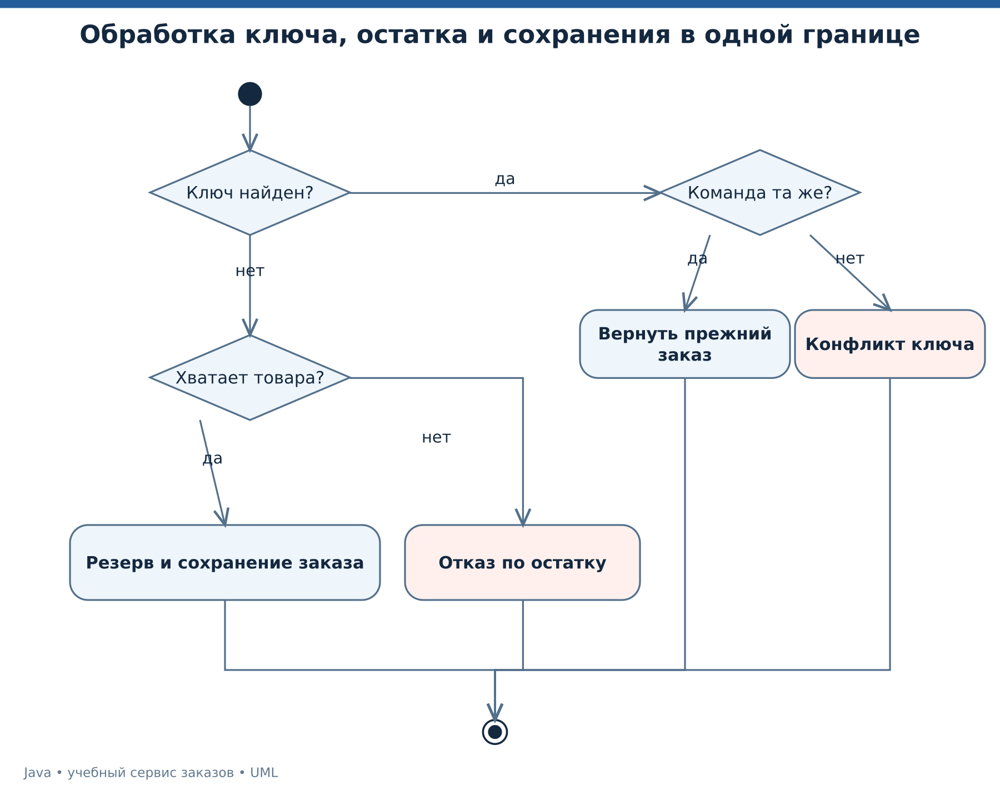
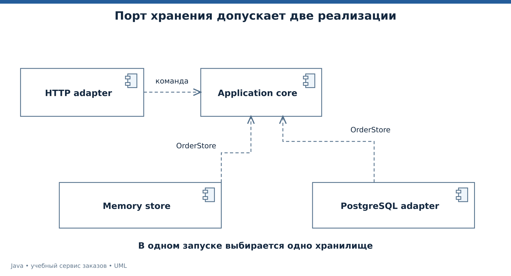
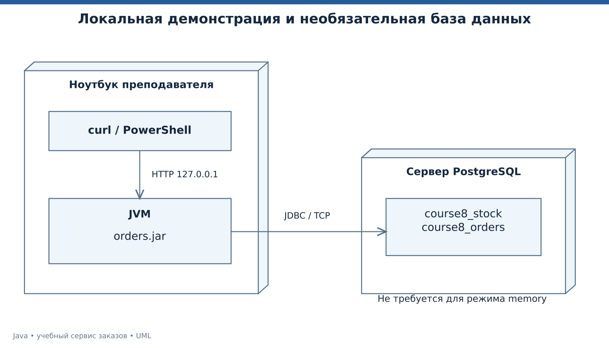

# Лекция 8. Профессиональное устройство Java-сервиса

Собираем результаты курса в небольшой проект с явными границами, бизнес-проверками, повторяемыми тестами и воспроизводимой сборкой. Итоговый сценарий резервирует товар и создаёт заказ. Автомат оплаты из лекции 2 остаётся отдельной моделью для изучения состояний — реальных платежей в финальном сервисе нет.

Профессиональный подход здесь означает проверяемые договоры и понятные ограничения. Учебный HTTP-сервер не объявляется готовой платформой для публичной эксплуатации.

[Все лекции](../README.md) · [Текст преподавателя](../speaker-notes/08-professional-service.md)

## Маршрут занятия

| Блок | Что разбираем |
|---|---|
| [L08-01](#l08-01) | Структура проекта и направление зависимостей |
| [L08-02](#l08-02) | Одна команда, один результат и повтор запроса |
| [L08-03](#l08-03) | Тестируем наблюдаемое поведение |
| [L08-04](#l08-04) | Живой HTTP-сервис и демонстрация клиенту |
| [L08-05](#l08-05) | Аннотации и рефлексия без магии |
| [L08-06](#l08-06) | Пакеты, модули и воспроизводимая сборка JAR |
| [L08-07](#l08-07) | JVM, память и диагностика по данным |
| [L08-08](#l08-08) | Современные модели, JNI и Foreign Function and Memory |
| [L08-09](#l08-09) | Развёртывание и честная граница готовности |
| [L08-10](#l08-10) | Защита проекта и итоговые задачи |

---

<a id="l08-01"></a>

## L08-01. Структура проекта и направление зависимостей

Финальный проект находится в [examples/08-service](../examples/08-service/). Его исходники разделены по обязанностям.

| Пакет | Назначение | Основные типы |
|---|---|---|
| `domain` | Значения и предметные отказы | `Command`, `Order`, `Receipt`, `OrderFailure` |
| `application` | Сценарий и порт хранилища | `OrderService`, `OrderStore` |
| `infrastructure` | Конкретные хранилища | `InMemoryOrderStore`, `JdbcOrderStore` |
| `http` | Входной формат и HTTP-ответы | `ApiServer` |
| `app` | Сборка зависимостей и запуск | `DemoMain`, `ServerMain` |

`OrderService` получает `OrderStore` и `Clock` через конструктор. Это ручное внедрение зависимостей. Сценарий не создаёт конкретную базу внутри каждого метода. В тесте можно подставить фиксированные часы, а в сервере — выбранное хранилище.



*UML классов сценария заказа и двух реализаций хранилища.* [Исходник UML](../diagrams/08-service-classes.puml).



*UML пакетов с направлением зависимостей.* [Исходник UML](../diagrams/08-packages.puml).

Пакет задаёт пространство имён и участвует в правилах доступа, но сам по себе не предотвращает любую нежелательную зависимость. Архитектурные правила нужно соблюдать в коде и проверять при изменениях. [Пакеты Java][JLS7].

В малом проекте слои добавляют несколько файлов. Их польза здесь проверяема — тест сценария не поднимает HTTP-сервер, а замена хранилища не меняет синтаксис входной команды. Если разделение не помогает конкретному изменению и проверке, его стоит пересмотреть.

---

<a id="l08-02"></a>

## L08-02. Одна команда, один результат и повтор запроса

Команда содержит `requestId`, `sku` и `quantity`. У идентификатора запроса ограниченный символьный формат, артикул также проверяется, количество допускается от 1 до 5. Финальный учебный каталог содержит `BOOK` по 149990 копеек. Это отдельные фиксированные данные текущей демонстрации.

Порт `OrderStore.place` обещает выполнить связанный переход. Для памяти одного процесса его реализация синхронизирована. Сначала проверяется ключ повтора. При совпавшей команде возвращается прежний заказ. При другом содержимом с тем же ключом возникает конфликт. Только новая команда может уменьшить остаток.



*UML деятельности атомарного оформления и обработки повторов.* [Исходник UML](../diagrams/08-idempotency.puml).

Результат демонстрации выводится из этого договора.

```bash
java tools/Run.java 08
```

```text
ORDER=O1
TOTAL_CENTS=299980
REPLAY=true
STOCK=1
```

Начальный остаток равен трём. Первая команда резервирует две единицы, поэтому остаток равен одной. Повтор возвращает тот же заказ и не резервирует ещё две. Стоимость `149990 × 2 = 299980` копеек.

Гарантия in-memory варианта действует в пределах жизни одного процесса и соблюдения его договора. После перезапуска память очищается. У дополнительного JDBC-адаптера ключ и результат сохраняются в PostgreSQL в одной транзакции с резервом, но фактическую интеграционную проверку нужно выполнить в подготовленной среде. [Ограничения PostgreSQL][PGCONSTRAINT], [транзакции][CONNECTION].

---

<a id="l08-03"></a>

## L08-03. Тестируем наблюдаемое поведение

Проверки находятся в [ServiceTest.java](../examples/08-service/tests/ServiceTest.java). Они используют стандартный JDK, поэтому для лекции не требуется загрузка тестового фреймворка. Проверки выбрасывают `AssertionError` явно и не зависят от включения Java assertions флагом `-ea`.

```bash
java tools/Run.java test
```

Ожидается `TESTS_PASSED=20`. Это число получено из двадцати вызовов проверяющих сценариев в файле, а не оценка процента покрытия.

| Группа | Что проверяется |
|---|---|
| Предметные правила | Сумма, время, количество, наличие товара |
| Повторы | Тот же ключ, изменённое содержимое, остаток после отказа |
| Конкурентность | Два запроса на единственный товар |
| HTTP | Создание, чтение, повтор, статусы, Allow, лимит тела, тип содержимого |

У каждого теста есть наблюдаемое обещание. Например, повтор должен вернуть прежний идентификатор и оставить остаток после первого резерва. Мы не проверяем количество внутренних вызовов `HashMap.put`, потому что это деталь выбранной реализации.

Тест конкурентного сценария запускает две задачи и проверяет один успешный резерв. Он подтверждает конкретный сценарий вместе с анализом синхронизации, но не является доказательством отсутствия любых ошибок конкурентности во всех будущих изменениях.

Проверки HTTP поднимают сервер на свободном локальном порту и закрывают его после выполнения. Проверки памяти не доказывают правильность JDBC-адаптера. Для PostgreSQL в [отдельной инструкции](../docs/JDBC-LAB.md) задана программа интеграционной проверки.

---

<a id="l08-04"></a>

## L08-04. Живой HTTP-сервис и демонстрация клиенту

Запуск сервера удерживает терминал до `Ctrl+C`. По умолчанию используется память, если `COURSE_JDBC_URL` не задана.

```bash
java tools/Run.java server
```

Сервер слушает только `127.0.0.1` и порт 8080. Для другого порта используйте `java tools/Run.java server 8081`. Во втором терминале отправьте команды. В PowerShell используйте `curl.exe`, чтобы явно вызвать утилиту curl; вариант через `Invoke-RestMethod` дан в [инструкции запуска](../docs/QUICKSTART.md).

```bash
curl -i http://127.0.0.1:8080/health
curl -i -X POST http://127.0.0.1:8080/orders -H "Content-Type: application/x-www-form-urlencoded" --data "key=lecture-1&sku=BOOK&quantity=2"
curl -i -X POST http://127.0.0.1:8080/orders -H "Content-Type: application/x-www-form-urlencoded" --data "key=lecture-1&sku=BOOK&quantity=2"
curl -i http://127.0.0.1:8080/orders/O1
```

При свежем in-memory запуске создание даёт `201` и заказ `O1`, повтор — `200` с тем же телом, чтение — `200`. Затем отправьте тот же ключ с количеством 1 — ожидается `409`. Отрицательное количество даёт `400`.

`O1` предсказуем только для свежей памяти примера. При работе с БД используйте фактический `Location` ответа. Последовательность идентификаторов может иметь пропуски, и это не является нарушением договора заказа.

Тело запроса ограничено 1024 байтами, повторяющиеся и неизвестные поля отклоняются. Эти меры не исчерпывают защиту публичного сервера от перегрузки и медленных клиентов. Демонстрация ограничена локальной машиной.

---

<a id="l08-05"></a>

## L08-05. Аннотации и рефлексия без магии

Аннотация описывает метаданные. Сама по себе она не открывает HTTP-путь и не запускает тест. Нужен инструмент или код, который её читает и выполняет согласованное действие. `@Retention(RUNTIME)` делает аннотацию доступной для соответствующего чтения во время выполнения. [Аннотации][JLS9], [Retention][RETENTION].

Отдельный [MetadataDemo.java](../examples/08-service/src/course/orders/app/MetadataDemo.java) объявляет `@Route`, находит аннотированный метод и вызывает его через reflection.

```java
@Retention(RetentionPolicy.RUNTIME)
@Target(ElementType.METHOD)
public @interface Route {
    String value();
}
```

```bash
java tools/Run.java metadata
```

```text
ROUTE=/health RESULT=UP
```

Это демонстрация механизма метаданных, а не второй web-фреймворк. Реальный `ApiServer` курса регистрирует обработчики явно и не использует этот учебный сканер.

`Method.invoke` имеет собственные правила доступа и обработки ошибок, включая обёртку исключения, брошенного вызываемым методом. Сигнатуры, типы результата и доступ нужно проверять. [Method][REFLECTION].

Рефлексия полезна для инструментов и инфраструктуры, но скрывает часть связей от обычного чтения прямых вызовов. Имена методов в строках легко рассогласовать при изменении кода. Глубокий доступ к закрытым членам дополнительно связан с границами модулей.

Профессиональный выбор — использовать метаданные там, где они сокращают осмысленную повторяемость, и сохранять возможность объяснить, кто именно их обрабатывает.

---

<a id="l08-06"></a>

## L08-06. Пакеты, модули и воспроизводимая сборка JAR

Пакеты организуют имена и доступ. Модуль задаёт зависимости и экспортируемые пакеты. `requires` выражает чтение другого модуля, `exports` — доступ к публичному API пакета при соблюдении остальных правил. `opens` относится к доступу для глубокой рефлексии, а не заменяет обычный экспорт. [Пакеты и модули][JLS7].

В проекте есть `module-info.java` с зависимостями от `jdk.httpserver` и `java.sql`. Для учебных проверок часть пакетов экспортируется. При проектировании библиотечного API экспорт должен быть осознанным.

```bash
java tools/Run.java jar
java -jar build/orders.jar
java --module-path build/orders.jar -m course.orders/course.orders.app.DemoMain
```

Два последних запуска выполняют одинаковую консольную демонстрацию. Первый использует исполняемый JAR, второй — именованный модуль. Сам JAR представляет архив классов и ресурсов с метаданными; его наличие не означает, что внутрь автоматически попала виртуальная машина или внешние драйверы. [Команда jar][JAR], [команда java][JAVA].

Файлы классов собираются в `build`, исходники остаются в `examples`. Каталог `build` исключён из учебного Git-набора. Команда сборки входит в репозиторий, чтобы другой человек мог повторить её.

Совместимость языка и API проверяется компиляцией с `--release 17` для основного маршрута. Это не эмуляция всех особенностей чужой JVM, но явное ограничение доступной версии платформенного API при компиляции. Дополнительные примеры компилируются отдельно с `--release 25`. [javac][JAVAC].

---

<a id="l08-07"></a>

## L08-07. JVM, память и диагностика по данным

Сборщик мусора может освобождать память недостижимых объектов. [Руководство GC][GC]. Он не закрывает по бизнес-договору файлы и соединения вместо `try-with-resources`. Если приложение сохраняет ссылки на ненужные элементы в бесконечно растущем кеше, наличие GC не устраняет такую утечку на уровне проекта.

Перед оптимизацией определяем симптом. Высокая задержка, рост памяти, нехватка CPU и очередь запросов требуют разных наблюдений. Из одного большого значения `-Xmx` нельзя вывести, что приложение стало быстрее или надёжнее.

JDK Flight Recorder позволяет собирать диагностические события. Для учебного знакомства после сборки JAR можно выполнить следующую команду. [Руководство java][JAVA], [инструмент jfr][JFR].

```bash
java -XX:StartFlightRecording=filename=build/demo.jfr,settings=profile,dumponexit=true -jar build/orders.jar
jfr summary build/demo.jfr
```

Короткий запуск даёт небольшой диагностический файл и не служит корректным бенчмарком. Для исследования задержек нужна репрезентативная нагрузка, длительность наблюдения и понятные показатели.

**Подтверждённый кейс Uber.** В официальном разборе настройки GC для Presto инженеры исследовали журналы сборки мусора, меняли параметры и проверяли поведение сначала на отдельных кластерах. [Публикация Uber Engineering][UBER].

Наш вывод из этого кейса — настройку нужно связывать с измеренным симптомом и проверять на своей нагрузке. Копировать флаги из чужой системы как универсальный рецепт нельзя. Численные результаты той статьи в этом курсе не переносятся на наш сервис.

---

<a id="l08-08"></a>

## L08-08. Современные модели, JNI и Foreign Function and Memory

Дополнительный [ModernModel.java](../examples/08-service/bonus25/ModernModel.java) показывает закрытый набор вариантов `sealed`, записи `record` и разбор вариантов через pattern matching в `switch`. Эти конструкции помогают выразить перечислимые формы команды. [Классы и sealed][JLS8], [switch и patterns][JLS14].

```java
sealed interface Action permits Reserve, Cancel {}
record Reserve(String sku, int quantity) implements Action {}
record Cancel(String id) implements Action {}
```

При добавлении нового разрешённого варианта исчерпывающий разбор должен быть пересмотрен. Это полезно там, где множество вариантов действительно контролируется приложением. Открытая иерархия расширений требует другого решения.

JNI связывает Java с native-кодом через специальный интерфейс. Foreign Function and Memory API предоставляет средства взаимодействия с внешними функциями и памятью. Эти технологии нужны для конкретных библиотек и задач, а не как обязательный этап любого Java-проекта. [Спецификация JNI][JNI], [Arena][ARENA].

В [NativeMemory.java](../examples/08-service/bonus25/NativeMemory.java) выделяется небольшой сегмент памяти, записывается 42, затем читается обратно.

```java
try (var arena = Arena.ofConfined()) {
    var segment = arena.allocate(ValueLayout.JAVA_INT);
    segment.set(ValueLayout.JAVA_INT, 0, 42);
    System.out.println(segment.get(ValueLayout.JAVA_INT, 0));
}
```

Арена задаёт время жизни сегмента и ограничения доступа. В данном примере не загружается внешняя native-библиотека и не вызывается её функция. Поэтому показана часть memory API, а не полный downcall.

Все дополнительные программы запускаются `java tools/Run.java bonus25` на JDK 25. Их фактическое выполнение не проверено в среде подготовки с JDK 17. Основной сервис не зависит от них и использует уже проверенную совместимую модель.

---

<a id="l08-09"></a>

## L08-09. Развёртывание и честная граница готовности

Вариант в памяти запускается одним процессом. Дополнительный `JdbcOrderStore` использует PostgreSQL. Выбор выполняет `ServerMain` по наличию `COURSE_JDBC_URL`. Для JDBC нужен драйвер в classpath и [подготовленная схема лекции 8](../examples/08-service/schema.sql). Полные команды и проверки приведены в [JDBC-LAB.md](../docs/JDBC-LAB.md).



*UML компонентов локального приложения и внешнего хранилища.* [Исходник UML](../diagrams/08-components.puml).



*UML развёртывания учебного приложения с необязательной PostgreSQL.* [Исходник UML](../diagrams/08-deployment.puml).

Таблица различает реализованное поведение и последующие задачи.

| Область | В этом комплекте | Перед внешней эксплуатацией |
|---|---|---|
| Сценарий заказа | Проверка команды, атомарный резерв, повтор | Уточнить полный договор бизнеса |
| Хранение | Память и исходник JDBC-адаптера | Интеграционные проверки, миграции, резервное копирование |
| Доступ | Loopback без авторизации | Аутентификация, права, защищённый транспорт |
| Нагрузка | Малый фиксированный пул, лимит тела | Ограниченные очереди, тайм-ауты, измерения нагрузки |
| Наблюдение | Коды ответа, журнал непредвиденных ошибок | Метрики, корреляция, готовность зависимостей |

JDBC-адаптер открывает новое соединение на операцию и не содержит пул. В нём нет полной политики тайм-аутов БД, миграционного инструмента или доставки событий. Эти ограничения перечислены, чтобы студент мог превратить их в следующие инженерные задачи.

Секреты и внешние настройки не коммитятся. В репозиторий включены код, схема, команды и проверяемый контракт. Компиляция адаптера подтверждена, работоспособность соединения в реальной PostgreSQL требует отдельного запуска по инструкции.

---

<a id="l08-10"></a>

## L08-10. Защита проекта и итоговые задачи

Итоговая работа — расширить сервис заказов одним осмысленным сценарием. Например, добавить отмену резерва с возвратом остатка. Требование должно определить, можно ли отменять повторно и как распознаётся повтор команды отмены.

Результат работы представляется как связанный набор.

- Описание входа, выхода, ограничений и отказов сценария.
- UML состояний или деятельности с точками изменения данных.
- Изменение доменной модели и нужного порта.
- Реализация с согласованной границей атомарности.
- Проверки обычного случая, отказов, повторов и конкуренции.
- Команды сборки и демонстрации из чистой копии проекта.

Вопросы для защиты помогают отличить понимание от копирования кода.

1. Что изменится после перезапуска сервиса в каждом варианте хранилища?
2. Где сформулирован договор равенства команды при повторе?
3. Почему Clock передаётся в конструктор?
4. Кто читает аннотацию и что произойдёт без такого обработчика?
5. Какой тест обнаружит двойной резерв последнего товара?
6. Какие утверждения о JDBC ещё требуют интеграционного подтверждения?

В [тексте преподавателя](../speaker-notes/08-professional-service.md#l08-10) есть ответы и разбор дополнительной задачи. Полная карта курса находится в [TEACHING-MAP.md](../docs/TEACHING-MAP.md), фактические результаты проверки комплекта — в [VERIFICATION.md](../docs/VERIFICATION.md).

Теперь путь от первой формулы до сервиса можно воспроизвести. Каждое новое средство языка появлялось в ответ на конкретную задачу — защитить значение, выразить преобразование, согласовать действия или сделать результат проверяемым.


## Официальные источники

[JLS7]: https://docs.oracle.com/javase/specs/jls/se25/html/jls-7.html "JLS 25, глава 7 — пакеты и модули"
[JLS8]: https://docs.oracle.com/javase/specs/jls/se25/html/jls-8.html "JLS 25, глава 8 — классы, конструкторы, record"
[JLS9]: https://docs.oracle.com/javase/specs/jls/se25/html/jls-9.html "JLS 25, глава 9 — интерфейсы и аннотации"
[JLS14]: https://docs.oracle.com/javase/specs/jls/se25/html/jls-14.html "JLS 25, глава 14 — операторы и управление потоком"
[JAVAC]: https://docs.oracle.com/en/java/javase/25/docs/specs/man/javac.html "JDK 25 — команда javac"
[JAVA]: https://docs.oracle.com/en/java/javase/25/docs/specs/man/java.html "JDK 25 — команда java"
[CONNECTION]: https://docs.oracle.com/en/java/javase/25/docs/api/java.sql/java/sql/Connection.html "Java SE 25 API — Connection"
[PGCONSTRAINT]: https://www.postgresql.org/docs/17/ddl-constraints.html "PostgreSQL 17 — Constraints"
[REFLECTION]: https://docs.oracle.com/en/java/javase/25/docs/api/java.base/java/lang/reflect/Method.html "Java SE 25 API — Method"
[RETENTION]: https://docs.oracle.com/en/java/javase/25/docs/api/java.base/java/lang/annotation/Retention.html "Java SE 25 API — Retention"
[JAR]: https://docs.oracle.com/en/java/javase/25/docs/specs/man/jar.html "JDK 25 — команда jar"
[JFR]: https://docs.oracle.com/en/java/javase/25/docs/specs/man/jfr.html "JDK 25 — команда jfr"
[JNI]: https://docs.oracle.com/en/java/javase/25/docs/specs/jni/design.html "JDK 25 — спецификация JNI, Design Overview"
[ARENA]: https://docs.oracle.com/en/java/javase/25/docs/api/java.base/java/lang/foreign/Arena.html "Java SE 25 API — Arena"
[UBER]: https://www.uber.com/au/en/blog/uber-gc-tuning-for-improved-presto-reliability/ "Uber Engineering — GC Tuning for Improved Presto Reliability"

- [JLS 25, глава 7 — пакеты и модули][JLS7]
- [JLS 25, глава 8 — классы, конструкторы, record][JLS8]
- [JLS 25, глава 9 — интерфейсы и аннотации][JLS9]
- [JLS 25, глава 14 — операторы и управление потоком][JLS14]
- [JDK 25 — команда javac][JAVAC]
- [JDK 25 — команда java][JAVA]
- [Java SE 25 API — Connection][CONNECTION]
- [PostgreSQL 17 — Constraints][PGCONSTRAINT]
- [Java SE 25 API — Method][REFLECTION]
- [Java SE 25 API — Retention][RETENTION]
- [JDK 25 — команда jar][JAR]
- [JDK 25 — команда jfr][JFR]
- [JDK 25 — спецификация JNI, Design Overview][JNI]
- [Java SE 25 API — Arena][ARENA]
- [Uber Engineering — GC Tuning for Improved Presto Reliability][UBER]

[GC]: https://docs.oracle.com/en/java/javase/25/gctuning/introduction-garbage-collection-tuning.html "JDK 25 — Introduction to Garbage Collection Tuning"
